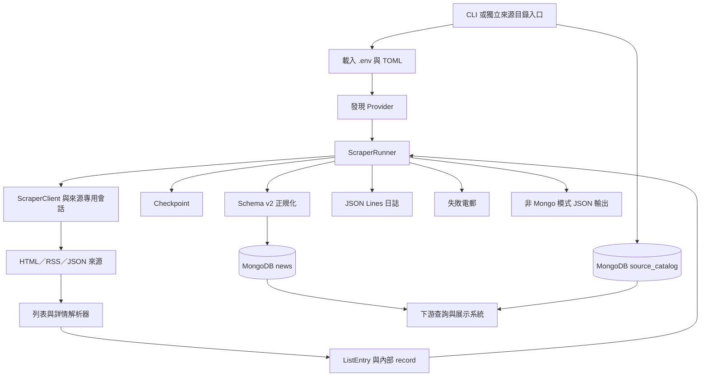
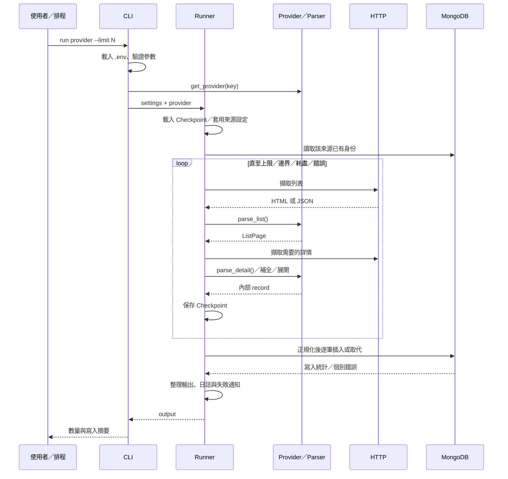

# Cyberclawer 開發與維運手冊

> 語言：繁體中文｜文件核對日期：2026-11-06（Asia/Hong_Kong）  
> Python 套件：`vuln-bulletin-scraper`｜套件版本：`0.1.0`｜CLI：`vuln-scrape`  
> 核對基準：Git 提交 `1133096`，以及撰寫時的工作副本。

本文件面向新加入的開發者、爬蟲維護者、MongoDB 資料使用者及部署人員。內容根據專案程式碼、設定、測試及本次本機驗證整理。章節中的「現行行為」描述目前已實作的功能；「建議」與部署範例則是可採用的開發或維運方式。

本次工作副本在文件建立前，已有 `vuln_scraper/scrapers/cve/parsers/list.py` 的修改：兩種 CVE 列表解析結果均標示 `exhausted=True`。本文件納入該行為；相關測試差異見[測試與驗證](#testing)。

## 目錄

1. [專案定位與閱讀路線](#overview)
2. [技術組成與目錄導覽](#layout)
3. [整體架構與資料流](#architecture)
4. [建立開發環境](#setup)
5. [設定系統與優先順序](#configuration)
6. [CLI 指令完整參考](#cli)
7. [內部資料模型](#models)
8. [MongoDB Schema v2 與資料字典](#schema)
9. [正規化、嚴重程度與時間](#normalization)
10. [Runner 執行流程與停止條件](#runner)
11. [Catch-up 日期視窗與資料完整性](#catch-up)
12. [HTTP、速率限制與恢復策略](#http)
13. [Checkpoint、輸出及本機狀態](#state)
14. [15 個資料來源的實作說明](#providers)
15. [新增、修改與移除 Provider](#extension)
16. [MongoDB 寫入、索引與查詢](#mongodb)
17. [來源目錄與下游整合](#catalog)
18. [資料遷移、備份及回復](#migration)
19. [日誌與失敗電郵](#observability)
20. [測試策略與本次驗證結果](#testing)
21. [常見問題與排查流程](#troubleshooting)
22. [部署、排程與日常維運](#deployment)
23. [開發流程、已知限制與改善方向](#maintenance)
24. [原始碼索引與交接清單](#reference)

<a id="overview"></a>
## 1. 專案定位與閱讀路線

### 1.1 專案解決的問題

Cyberclawer 從不同機構、漏洞目錄和軟件供應商收集漏洞公告，將 HTML、RSS、JSON API 及 CVE v5 記錄整理成共用資料格式，寫入 MongoDB，供其他系統查詢、分類或展示。

核心能力如下：

- 以終端指令執行單一來源或多來源的資料收集。
- 自動發現 `vuln_scraper/scrapers/` 下的 Provider 套件。
- 分離列表解析、詳情解析與共用執行流程。
- 透過非同步 HTTP、限速、有限次重試及退避處理暫時性錯誤。
- 支援香港時區的日期視窗收集。
- 將所有來源寫入同一個 `news` 實體集合，以 `source.provider` 區分。
- 保留來源特有的內容、受影響版本、修補建議、CVE 關聯及參考連結。
- 記錄失敗、保存執行狀態，並在設定允許時寄送失敗通知。
- 將歷史集合遷移至 v2，或合併成統一的 `news` 集合。
- 發佈 `source_catalog`，讓下游即使在某來源沒有公告時仍可顯示來源選項。

### 1.2 系統邊界

本儲存庫的主要產品是 Python 套件與 CLI。程式碼中沒有網站前端、REST 伺服器或常駐排程器。README 提到的入口網站／Portal 是下游使用者，並非此儲存庫內建的應用程式。

`reclassify-cve` 的 CLI 接口及分類相關測試仍然存在，但本次工作副本沒有 `vendor_product_classifier/` 的實作，不能把該指令視為目前可直接使用的完整功能。

### 1.3 建議閱讀路線

| 角色／目的 | 優先閱讀 |
| --- | --- |
| 第一次啟動專案 | 第 4、5、6、20 章 |
| 修改既有爬蟲 | 第 7、10、12、14、15、20 章 |
| 新增資料來源 | 第 7、8、9、14、15 章 |
| 對接 MongoDB／Portal | 第 8、9、16、17 章 |
| 部署及排程 | 第 5、11、13、19、21、22 章 |
| 升級舊資料庫 | 第 8、16、18 章 |
| 接手維護 | 第 20、23、24 章 |

### 1.4 先掌握的五個概念

1. **Provider**：一個來源的請求方式、解析器與執行選項。
2. **ListEntry**：列表上的公告身份、摘要與可能已內嵌的詳情。
3. **Runner**：負責翻頁、取詳情、選取結果、保存狀態及寫入資料庫。
4. **Schema v2**：持久化到 MongoDB 的共用資料契約。
5. **Checkpoint**：本機進度、失敗及部分恢復資訊；它不是 MongoDB 的替代品。

<a id="layout"></a>
## 2. 技術組成與目錄導覽

### 2.1 套件與相依項目

以下版本來自 `pyproject.toml`，表示專案宣告的最低要求，並非鎖定版本。

| 項目 | 宣告要求 | 用途 |
| --- | --- | --- |
| Python | `>=3.11` | `tomllib`、非同步執行、型別及資料模型 |
| setuptools | `>=68` | 建置與套件發現 |
| beautifulsoup4 | `>=4.12.0` | HTML 解析 |
| httpx | `>=0.27.0` | 非同步 HTTP 請求 |
| lxml | `>=5.0.0` | HTML／表格解析後端 |
| pymongo | `>=4.7.0` | MongoDB 連線與操作 |
| quickjs（`avd`、`cnvd` 額外套件） | `>=1.0.0` | 來源特有的 JavaScript 驗證處理 |
| requests（`avd`、`cnvd` 額外套件） | `>=2.31.0` | 特定來源的同步 HTTP 流程 |
| ddddocr（`cnvd` 額外套件） | `>=1.5.0` | CNVD 圖像驗證辨識 |
| pytest（`dev` 額外套件） | `>=8.0.0` | 測試 |

目前沒有已提交的相依版本鎖定檔，也沒有在本儲存庫中宣告 Ruff、mypy、Black 等工具設定。

### 2.2 主要目錄

```text
cyberclawer/
├── README.md                         # 英文快速入門
├── database.md                       # 統一 MongoDB v2 格式與遷移說明
├── instruction.md                    # 既有新增爬蟲檢查清單
├── pyproject.toml                    # 套件、依賴、CLI 入口
├── mongodb.toml                      # MongoDB 共用設定
├── scrapers.toml                     # Provider 選擇、重試與電郵設定
├── update_source_collection.py       # 只同步來源目錄的獨立入口
├── docs/
│   └── DEVELOPMENT.zh-Hant.md        # 本手冊
├── vuln_scraper/
│   ├── cli.py                        # 指令定義與分派
│   ├── config.py                     # 設定模型、預設值與載入
│   ├── env_file.py                   # 專案 .env 載入
│   ├── models.py                     # 身份、列表及詳情資料模型
│   ├── runner.py                     # 共用爬取流程及 Checkpoint
│   ├── client.py                     # HTTP、限速、退避與錯誤型別
│   ├── catch_up.py                   # 多來源日期視窗執行
│   ├── schema_v2.py                  # 持久化格式、清理、驗證及索引
│   ├── mongo.py                      # 去重、衝突處理及寫入統計
│   ├── migrate_mongo.py              # 影子集合、合併、備份與清理
│   ├── severity.py                   # 嚴重程度正規化
│   ├── timestamps.py                 # 時間解析與香港日期視窗
│   ├── table_extractor.py            # HTML 表格展開
│   ├── source_catalog.py             # 發佈啟用來源名單
│   ├── error_log.py                  # JSON Lines 日誌
│   ├── email_alerts.py               # SMTP 通知及重複抑制
│   ├── filters.py                    # 數量上限檢查
│   └── scrapers/
│       ├── __init__.py               # Provider Protocol 與自動發現
│       └── <provider>/
│           ├── config.py             # 端點與來源常數
│           ├── provider.py           # Provider 實作
│           └── parsers/
│               ├── list.py           # 列表 → ListPage
│               └── detail.py         # 詳情 → 可 to_dict() 的資料物件
├── tests/
│   ├── test_*.py                     # 共用流程及資料契約測試
│   └── scrapers/<provider>/          # Provider 測試與 HTML／JSON 樣本
└── data/                             # 本機狀態；已被 Git 忽略
```

AVD 另有 `h.py`，CNVD 另有 `session.py` 及 `crawler_ng/getter.py`。正常 CLI 的 CNVD 會話流程由 `session.py` 提供，不需要先手動執行 `crawler_ng/getter.py`。

### 2.3 共用模組的責任分界

| 層 | 應處理 | 不宜放入 |
| --- | --- | --- |
| `config.py` | 設定讀取、預設值、優先順序 | 外站 DOM 選擇器 |
| `provider.py` | 端點、HTTP 方法、來源能力、欄位補全 | 共用 MongoDB 寫入流程 |
| `parsers/` | 已取得內容的解析、型別與欄位轉換 | 真實網絡請求、SMTP |
| `client.py` | HTTP、限速、重試與回應錯誤 | 個別供應商的業務欄位 |
| `runner.py` | 編排、選取、停止條件、狀態與失敗 | 大量來源專用 DOM 邏輯 |
| `schema_v2.py` | 正規化及資料契約 | 頁面擷取 |
| `mongo.py` | 持久化、比對、衝突與結果統計 | HTML 解析 |

<a id="architecture"></a>
## 3. 整體架構與資料流

### 3.1 系統元件



### 3.2 單次正常執行



### 3.3 執行及併發模型

目前 `catch-up` 依選定 Provider 的順序逐一執行，沒有同時跑 15 個來源。單一來源的部分詳情流程使用 `asyncio.gather()` 和 Semaphore 控制併發；HTTP 請求共用該 Client 的限速器。

日期視窗流程 `_scrape_updated_since_records()` 為了逐筆判斷時間，主要依序取得詳情。MongoDB 使用同步 PyMongo，並不是非同步 MongoDB 驅動。AVD 與 CNVD 的部分同步工作透過 `asyncio.to_thread()` 執行。

<a id="setup"></a>
## 4. 建立開發環境

### 4.1 基本安裝

在專案根目錄執行：

```bash
python3.11 -m venv .venv
source .venv/bin/activate
python -m pip install -e '.[dev]'
```

`-e` 是可編輯安裝，修改 Python 原始碼後通常不需要重新安裝。修改套件中繼資料或 CLI 入口時，應重新執行安裝。

若需要本設定中列出的全部來源：

```bash
python -m pip install -e '.[dev,avd,cnvd]'
```

個別額外套件亦可分開安裝：

```bash
python -m pip install -e '.[avd]'
python -m pip install -e '.[cnvd]'
```

預設 `scrapers.toml` 選用了 AVD 和 CNVD，因此只安裝基本依賴後直接執行全部來源，未必具備這兩個來源所需的模組。開發時可先只選擇正在維護的來源。

### 4.2 MongoDB 設定

將開發資料庫設定為獨立名稱，例如：

```toml
[mongodb]
uri = "mongodb://localhost:27017"
database = "vulnerabilities_dev"
collection = "news"
conflict = "overwrite"
```

亦可在專案根目錄建立 `.env`：

```dotenv
MONGO_URI=mongodb://localhost:27017
MONGO_DB=vulnerabilities_dev
MONGO_COLLECTION=news
```

`.env` 已被 Git 忽略。範例使用示意設定；實際帳密與 Token 應留在各環境的設定中。

儲存庫的 `mongodb.toml` URI 帶有 `/myDatabase`，但同時明確指定 `database = "vulnerabilities"`。程式以明確解析出的 `mongo_database` 選擇操作的資料庫；URI 中的路徑亦可能影響驅動的認證設定，部署時應使兩者符合預期。

### 4.3 不連線即可做的基本檢查

```bash
python -m vuln_scraper.cli --help
python -m vuln_scraper.cli run --help
python -m vuln_scraper.cli catch-up --help
python -m vuln_scraper.cli sync-source-catalog --dry-run
python update_source_collection.py --dry-run
```

最後兩個 `--dry-run` 會顯示來源目錄，不建立 MongoDB 連線，也不啟動爬蟲。其他遷移指令的 `--dry-run` 需要讀取資料庫，意義不同。

### 4.4 首次實際收集

確認開發 MongoDB 可用，並設定好開發用電郵通知行為後，可先小量執行：

```bash
vuln-scrape run govcert --limit 2
```

此指令會連接外站並寫入設定的 MongoDB。確認資料中的 `schema_version`、`source.provider`、標題、日期與詳情後，再增加數量或啟用其他來源。

### 4.5 工作目錄規則

一般 CLI 從**目前工作目錄**讀取 `.env`、`mongodb.toml`、`scrapers.toml`，相對的 `data/` 也跟隨目前工作目錄。將程式安裝到虛擬環境，不代表設定一定從原始碼所在位置讀取。

`update_source_collection.py` 是例外：它會先切換到腳本所在的儲存庫根目錄，再分派 `sync-source-catalog`，因此可從其他目錄呼叫而仍使用此 checkout 的設定。

<a id="configuration"></a>
## 5. 設定系統與優先順序

### 5.1 設定來源

| 來源 | 範圍 | 主要讀取位置 |
| --- | --- | --- |
| 程序環境變數 | MongoDB、Token、SMTP 等 | `config.py`、各 Provider、`email_alerts.py` |
| 目前目錄 `.env` | 補入程序環境 | `env_file.py`，由 CLI `main()` 呼叫 |
| `mongodb.toml` | 共用資料庫與衝突模式 | `load_mongo_config()` |
| `scrapers.toml` | 選用來源、重試、日誌及電郵 | `load_scrapers_config()` |
| `ScraperSettings` | 程式整合時明確給定參數 | `config.py` |
| Provider 預設值 | 來源限速、併發及行為 | 各 `provider.py` |

### 5.2 MongoDB 優先順序

URI、資料庫、集合依序採用：

1. `ScraperSettings` 中非空的明確值。
2. 環境變數 `MONGO_URI`、`MONGO_DB`、`MONGO_COLLECTION`。
3. 對應的舊環境變數 `AVD_MONGO_URI`、`AVD_MONGO_DB`、`AVD_MONGO_COLLECTION`。
4. `mongodb.toml` 的 `uri`、`database`、`collection`。
5. 內建值：`mongodb://localhost:27017`、`vulnerabilities`、`news`。

不是每個 CLI 指令都有對應的連線旗標。`run` 與 `catch-up` 的解析器沒有 `--mongo-uri`、`--database` 或 `--collection`；需透過環境／TOML 設定。遷移等指令另有特定的覆寫參數，詳見第 6 章。

衝突模式的解析為：`ScraperSettings.mongo_conflict` → TOML `conflict` → `prompt`。目前沒有 `MONGO_CONFLICT` 環境變數的解析邏輯。

### 5.3 `.env` 支援範圍

自製載入器支援空行、以 `#` 開頭的整行註解、`export KEY=value` 及成對單／雙引號。預設不覆蓋已存在的程序環境變數。

載入器不進行變數展開、Shell 命令執行或完整 dotenv 語法解析。避免假設 `${NAME}` 或行尾 `# 註解` 會按 Shell 的方式處理。直接從 Python 呼叫 Runner 時，也不會自動執行 CLI 的 `.env` 載入步驟。

### 5.4 `ScraperSettings` 參數表

| 欄位 | 內建預設 | 說明 |
| --- | --- | --- |
| `limit` | `1000` | 範圍 1–1000 |
| `mongo_enabled` | `False` | 資料類別預設；CLI 的預設設定工廠使用 `True` |
| `mongo_uri` | `None` | 正規化後解析實際連線字串 |
| `mongo_database` | `None` | 正規化後解析實際資料庫 |
| `mongo_collection` | `None` | 所有 Provider 共用 |
| `mongo_config_file` | `mongodb.toml` | 可由 Python 傳入其他路徑 |
| `mongo_conflict` | `None` | `skip`、`overwrite` 或 `prompt` |
| `mongo_interactive` | `False` | `prompt` 只有在此值為真才會詢問 |
| `request_delay` | `1.0` 秒 | 可能由 Provider 的預設值取代 |
| `concurrency` | `3` | 詳情擷取併發上限；可能套用 Provider 值 |
| `retries` | `3` | 重試次數，不包含第一次請求 |
| `backoff_base` | `1.0` 秒 | 指數退避基底 |
| `backoff_max` | `30.0` 秒 | 本地退避上限；不壓低 `Retry-After` |
| `backoff_jitter` | `0.4` 秒 | 追加的隨機延遲上界 |
| `session_max_retries` | `None` | CNVD 預設補成 50 |
| `session_retry_delay` | `None` | CNVD 預設補成 0.3 秒 |
| `scrapers_config_file` | `scrapers.toml` | 重試及通知設定檔 |
| `error_log` | `scraper-errors.log` | 寫入 `data_dir` 下的檔名 |
| `timeout` | `30.0` 秒 | 一般 HTTP Client 的 timeout 設定 |
| `data_dir` | `data` | 本機狀態目錄 |
| `output_file` | `data/high_risk_vulns.json` | 非 Mongo 模式的彙總 JSON |
| `checkpoint_file` | `data/checkpoint.json` | Checkpoint 路徑 |

`normalized()` 在呼叫端改了 `data_dir`、但未自訂兩個檔案路徑時，會把預設輸出和 Checkpoint 改放到新的 `data_dir`。

### 5.5 重試設定與一個重要細節

設定檔先將 `[scrapers.defaults]` 與 `[scrapers.<provider>]` 合併，後者覆蓋前者。例如目前：

```toml
[scrapers.defaults]
retries = 3
backoff_base = 1.0
backoff_max = 30.0
backoff_jitter = 0.4
error_log = "scraper-errors.log"

[scrapers.cnvd]
retries = 5
backoff_base = 10.0
backoff_max = 60.0
session_max_retries = 50
session_retry_delay = 0.3

[scrapers.nvd]
retries = 6
backoff_base = 10.0
backoff_max = 60.0

[scrapers.cve]
retries = 5
backoff_base = 2.0
```

`ScraperSettings.for_provider()` 以「欄位是否等於內建預設」決定是否套用設定檔。因此，明確傳入 `retries=3` 並不能表示「禁止來源設定改寫它」，因為 3 正好是內建預設。若需要測試零重試，傳入 `retries=0` 並以 `scrapers_config_file=None` 隔離設定較清楚。

`request_delay` 和 `concurrency` 也有相似規則：值分別等於 1.0 和 3 時，才套用來源預設。`scrapers.toml` 的重試載入器不解析任意欄位；目前不能只加入 `timeout` 或 `concurrency` 就期待生效。

### 5.6 Catch-up 來源選擇

```toml
[scrapers.catch_up]
providers = ["hkcert", "cve", "cnvd"]
```

- 省略 `providers` 或使用 `["all"]`：執行全部已發現來源。
- 使用 `[]`：不執行來源；若 MongoDB 啟用，來源目錄亦會發佈空名單。
- 重複值和空白值會整理。
- 未知來源會記錄警告並略過。
- 不可混合 `"all"` 與具體來源，否則拋出設定錯誤。
- 來源 key 區分大小寫，應使用小寫。

### 5.7 常用環境變數

| 變數 | 用途／適用範圍 |
| --- | --- |
| `MONGO_URI`、`MONGO_DB`、`MONGO_COLLECTION` | MongoDB 共用路由 |
| `AVD_MONGO_URI`、`AVD_MONGO_DB`、`AVD_MONGO_COLLECTION` | 舊名稱相容，優先度低於新名稱 |
| `GITHUB_TOKEN` | GitHub Advisory 的 Bearer 認證 |
| `NVD_API_KEY` | NVD 請求的 `apiKey` Header |
| `AVD_COOKIE`、`AVD_COOKIES`、`ALIYUN_AVD_COOKIE` | 依此順序選用 AVD Cookie |
| `HUAWEI_SA_X_CK` | Huawei SA 的 `x-ck` Header |
| `HUAWEI_SA_CSRF_TOKEN` | Huawei SA 的 `x-csrf-token` Header |
| `SMTP_HOST`、`SMTP_PORT` | SMTP 主機及埠 |
| `SMTP_FROM`、`SMTP_USERNAME`、`SMTP_PASSWORD` | 寄件及可選認證 |
| `SMTP_USE_TLS`、`SMTP_USE_SSL` | STARTTLS／直接 SSL 模式 |
| `MONGO_INTEGRATION_URI` | 真實 MongoDB 整合測試專用；不是正常執行設定 |

<a id="cli"></a>
## 6. CLI 指令完整參考

### 6.1 入口

安裝後可使用 `vuln-scrape`，或在專案環境執行 `python -m vuln_scraper.cli`。沒有子指令時會印出說明並以狀態碼 2 結束。最外層停用縮寫旗標。

### 6.2 `run`

```text
vuln-scrape run <provider> --limit 100
```

| 參數 | 預設 | 說明 |
| --- | --- | --- |
| `provider` | 必填 | 例如 `cve`、`govcert`、`fortiguard` |
| `--limit` | `1000` | 1–1000；選取的結果上限 |

此指令預設啟用 MongoDB。它不是固定「只插入新身份」的模式：在目前 TOML 的 `overwrite` 設定下，也會抓取和比對已存在的公告，以更新內容。

終端摘要包含擷取數量、詳情數量、`inserted`、`overwritten`、`deleted`、`skipped`、`conflicts`。正常寫入流程沒有刪除公告的動作，`deleted` 是保留的統計欄位。

### 6.3 `catch-up`

```bash
vuln-scrape catch-up
vuln-scrape catch-up --days 7 --limit 200
```

| 參數 | 預設 | 現行效果 |
| --- | --- | --- |
| `--limit` | `1000` | 每個來源的結果上限，1–1000 |
| `--days` | `1` | 至今包含幾個香港曆日，最少 1 |
| `--batch-size` | `5` | 解析及驗證仍存在；現行日期流程沒有使用分批迴圈 |
| `--max-runs-per-provider` | `100` | 解析仍存在；現行日期流程每個來源只建立一次 Runner |

CLI 的英文說明仍提及重複執行至重疊，但應以 `catch_up.py` 的日期視窗實作為準。兩個歷史參數不會使同一來源自動執行 100 次，也不會將總上限乘大。

### 6.4 `sync-source-catalog`

```bash
vuln-scrape sync-source-catalog --dry-run
vuln-scrape sync-source-catalog
```

`--dry-run` 只輸出 JSON；正式執行以 `replace_one(..., upsert=True)` 更新 `source_catalog/_id=active`，不爬取公告、不修改 `news`。

### 6.5 `migrate-mongo`

```bash
vuln-scrape migrate-mongo --dry-run
vuln-scrape migrate-mongo --database vulnerabilities_dev --target-version 2
```

| 參數 | 預設 | 說明 |
| --- | --- | --- |
| `--dry-run` | 關閉 | 讀取資料，報告預期轉換，不寫入 |
| `--target-version` | `2` | 目前只支援 2 |
| `--no-validate` | 關閉 | 略過額外影子比對；仍有轉換及文件驗證 |
| `--database` | 設定解析結果 | 指定資料庫 |

此指令處理發現到的舊來源集合，與將集合合併到 `news` 的 `unify-mongo` 不同。CLI 沒有 `--source-collection`，但 Python 函式可接受 `collections=`。

### 6.6 `unify-mongo`

```bash
vuln-scrape unify-mongo --dry-run
vuln-scrape unify-mongo --database vulnerabilities_dev
vuln-scrape unify-mongo --dry-run \
  --source-collection legacy_cve \
  --source-collection vendor_alerts
```

| 參數 | 預設 | 說明 |
| --- | --- | --- |
| `--dry-run` | 關閉 | 讀取並轉換檢查，不切換集合 |
| `--collection` | `news` | 合併目標；此預設不自動改成 TOML 的自訂集合 |
| `--database` | 設定解析結果 | 指定資料庫 |
| `--source-collection` | 自動發現 | 可重複指定來源實體集合 |

若正式集合改名，應同時核對 runtime 的 `MONGO_COLLECTION`／TOML 及此指令的 `--collection`。明確列出來源時，請將需要保留的現有目標資料亦納入來源列表，詳見第 18 章。

### 6.7 `cleanup-mongo-backups`

```bash
vuln-scrape cleanup-mongo-backups --dry-run --older-than-days 7
vuln-scrape cleanup-mongo-backups --older-than-days 7
```

可用 `--database` 覆寫資料庫。`--older-than-days` 預設 7，函式拒絕小於 7 的值。正式執行會刪除符合命名與保留期條件的備份集合。

### 6.8 `reclassify-cve`

```text
reclassify-cve [--dry-run] [--database NAME] [--limit N] [--zero-shot]
```

解析器支援以上參數。執行分支會匯入 `vendor_product_classifier.mongo_utils` 及 `vendor_product_classifier.reclassify_cve`，目前 checkout 缺少該套件，因此即使有 `--dry-run` 仍會在匯入時失敗。需要取得相符實作及其設定後，才能另外驗證分類流程。

### 6.9 沒有的選項與結束狀態

此版本沒有 `review`、`backfill-severity`、`--mongo-sync`、`--mongo-filter-tui`、`--browser-headed` 或 `--include-manual-verification` 等舊選項。

參數錯誤通常經 `argparse` 以 2 結束；`unify-mongo` 如回傳 `validation_error` 會以 1 結束。一般 `run` 捕捉到列表失敗時，Runner 可回傳包含 `failed` 的正常輸出；個別 MongoDB 寫入失敗則收在 `mongo_sync.errors`。因此排程不可只憑程序回傳 0 就判定所有公告都成功。

<a id="models"></a>
## 7. 內部資料模型

### 7.1 `VulnerabilityId`

```python
from vuln_scraper.models import VulnerabilityId

identity = VulnerabilityId.parse("CVE-2026-10000")
assert identity.type == "CVE"
assert identity.code == "2026-10000"
assert identity.key == "CVE:2026-10000"
assert identity.display == "CVE-2026-10000"
```

`parse()` 使用字母前綴加 `-` 的模式，將型別轉為大寫。含底線的類型等情況可直接建立資料類別，例如 `VulnerabilityId(type="HUAWEI_SA", code="...")`；不應假定所有顯示 ID 都能由 `parse()` 解析。

### 7.2 `ListEntry`

| 欄位 | 說明 |
| --- | --- |
| `identity` | 來源自身的穩定身份 |
| `title` | 列表標題；某些 Provider 在詳情取得後更新 |
| `vuln_type` | 內部漏洞類型或公告類型 |
| `disclosure_date` | 列表日期或來源提供的日期字串 |
| `status` | 來源狀態／嚴重程度／`new`／`updated` 等原始訊息 |
| `provider` | 小寫來源 key |
| `source_url` | 列表或來源首頁 |
| `embedded_detail` | 列表已帶的詳情，或帶 `_list_summary=True` 的摘要 |

`entry.key` 是 `provider:code`，用於 Runner 與儲存身份；`identity.key` 則是原始型別加 code，兩者不可混用。

例如 GHSA 的顯示身份可能是 `GHSA-xxxx-yyyy-zzzz`，但持久化身份前綴是 `github_advisory:`。

### 7.3 `ListPage`

| 欄位 | 說明 |
| --- | --- |
| `page` | 邏輯頁碼 |
| `entries` | `ListEntry` 陣列 |
| `total_pages` | 已知總頁數，可缺省 |
| `total_records` | 來源回報的總記錄數，可缺省 |
| `start_index` | API 偏移量等資訊 |
| `results_per_page` | 回應中提供的頁面數量資訊 |
| `exhausted` | Parser 是否已確認空頁是合法結束；預設 `False` |

空 `entries` 本身不代表正常完成。當來源不能提供可靠的結束證據時，應保留 `exhausted=False`，避免把版面改動或被攔截誤當為沒有新資料。

### 7.4 `to_record()` 的中間格式

```json
{
  "type": "govcert",
  "code": "1234",
  "title": "示例安全公告",
  "cve_code": "2026-10000",
  "cve_codes": ["2026-10000"],
  "vuln_type": "Security Alert",
  "disclosure_date": "2026-11-06",
  "status": "High",
  "details": {
    "govcert": {
      "description": "示例內容",
      "cve_ids": ["CVE-2026-10000"]
    }
  },
  "source": {
    "provider": "govcert",
    "url": "https://example.test/alerts",
    "detail_url": "https://example.test/alerts/1234"
  }
}
```

這是爬蟲內部和非 Mongo 輸出使用的格式，包含舊欄位名稱及 `details.<provider>` 包裝。持久化前會轉成 v2，不能直接以此例作為下游資料庫契約。

### 7.5 CVE 輔助函式

- `normalize_cve_code()` 接受帶或不帶 `CVE-` 的有效字串，回傳 `YYYY-NNNN...`。
- `cve_codes()` 從數種詳情欄位提取 CVE，保留首次出現順序並去重。
- `canonical_cve_id()` 位於 `schema_v2.py`，回傳完整的 `CVE-YYYY-NNNN...`。
- `cve` 來源的 `to_record()` 不建立一般來源的 `cve_code`／`cve_codes` 關聯，CVE 身份由自身 code 表示。

<a id="schema"></a>
## 8. MongoDB Schema v2 與資料字典

### 8.1 統一儲存方式

所有現行來源共用一個實體集合，預設為 `vulnerabilities.news`。來源歸屬必須從 `source.provider` 取得；Provider 上的 `default_mongo_collection` 主要保留給舊資料集合的發現用途，不代表 runtime 仍分來源寫入。

以下是示意的 MongoDB Extended JSON：

```json
{
  "_id": "govcert:1234",
  "schema_version": 2,
  "code": "1234",
  "title": "示例安全公告",
  "severity": "High",
  "published_at": {"$date": "2026-11-05T16:00:00Z"},
  "updated_at": {"$date": "2026-11-05T16:00:00Z"},
  "observed_at": {"$date": "2026-11-06T01:00:00Z"},
  "source": {
    "provider": "govcert",
    "url": "https://example.test/alerts",
    "detail_url": "https://example.test/alerts/1234"
  },
  "cve_ids": ["CVE-2026-10000"],
  "details": {
    "content": "公告全文",
    "affected_systems": ["示例產品"],
    "recommendation": ["安裝供應商修補程式"]
  }
}
```

### 8.2 共用欄位

| 欄位 | 必填 | 型別 | 語意 |
| --- | --- | --- | --- |
| `_id` | 是 | 非空字串 | 正常新寫入為 `provider:code`；遷移保留舊 `_id` |
| `schema_version` | 是 | 整數 `2` | 文件格式版本 |
| `code` | 是 | 非空字串 | 來源自身的身份 code |
| `title` | 是 | 非空字串 | 來源標題；清理後空值會退回 code |
| `observed_at` | 是 | BSON Date | 實際儲存版本的觀察時間 |
| `source` | 是 | Object | 至少包含 `provider` |
| `details` | 是 | Object | 來源特有內容，可為空物件 |
| `severity` | 否 | 字串 | 僅儲存 `Critical`、`High`、`Medium`、`Low` |
| `change_type` | 否 | 字串 | 僅 `new` 或 `updated` |
| `published_at` | 否 | BSON Date | 公開日期／時間 |
| `updated_at` | 否 | BSON Date | 來源更新時間；必要時由公開日期等回退 |
| `cve_ids` | 否 | 唯一字串陣列 | 非 `cve` 來源關聯到的完整 CVE ID |
| `classification` | 否 | Object | 應用語意上只用於 `cve` 來源 |

`details` 直接放來源內容，沒有第二層 `details.govcert` 或 `details.cve`。下游先檢查 `source.provider`，再依需要解讀來源特有欄位。

### 8.3 `source` 物件

`source` 只保留 `provider`、`url`、`detail_url`。若兩個 URL 相同，正規化可能省略 `url`，因此下游不能要求兩個 URL 都存在。

來源 key 的 Schema 清單比目前可執行的 15 個 Provider 更大，包含若干歷史來源。這是為了保留資料相容性，並不代表這些歷史爬蟲仍然可執行。

### 8.4 CVE 身份與來源身份

```text
cve:2026-10000       # CVEProject 來源；code = 2026-10000
nvd:CVE-2026-10000   # NVD 來源；code 保留完整 CVE ID
msrc:2026-10000      # Microsoft 來源；由月報展開的 CVE
```

這三筆可以同時存在。系統以來源公告為單位保存，沒有自動把相同 CVE 的不同來源合併成單一文件。

`cve` 來源不儲存頂層 `cve_ids`，其 CVE ID 由 `"CVE-" + code` 得到；其他來源的 `cve_ids` 則為正規化並去重的關聯。

### 8.5 清理規則

持久化前會：

1. 將 `details.<provider>` 攤平。
2. 移除空字串、`None`、空陣列及空物件，保留 `False` 與 `0`。
3. 移除 `raw`、`raw_tables`、`raw_sections`。
4. 移除 Provider 指定的易變欄位，如閱讀次數及相鄰文章。
5. 將身份、日期、嚴重程度及 CVE 等資訊放入共用欄位。
6. 移除與共用欄位語意相同的部分詳情欄位，減少重複。
7. 對不能映射為 `change_type`、也不是重複資訊的原始狀態，可能保存為 `details.source_status`。

專用的 `tables`、`description_tables` 或其他結構化欄位不會只因名字包含 table 就全部移除。若希望某張表長期保存，應由 Parser 產出有語意的欄位，而非只依賴共用的 `raw_tables`。

### 8.6 不再儲存的頂層欄位

v2 禁止的舊頂層欄位包括：

```text
type, cve_code, cve_codes, related_cves, related_cve_ids,
vuln_type, disclosure_date, published_time, updated_time,
scraped_at, status
```

下游應使用 `source.provider`、`cve_ids`、`published_at`、`updated_at` 及 `observed_at`。不要因內部 `output` 還有 `scraped_at` 就要求 MongoDB 存同名欄位。

### 8.7 驗證的實際範圍

`mongo_json_schema("news")` 的頂層使用 `additionalProperties=False`，而 `details` 保留開放物件。影子遷移會用 strict/error 驗證器建立新集合。

一般 runtime 寫入會建立索引，但不會自動為首次建立的集合安裝上述 strict 驗證器。`build_v2_document()` 執行轉換，亦不等同完整呼叫 `validate_v2_document()`。需要強制資料契約的部署應檢查實際集合的 validator 設定。

統一集合的 MongoDB Schema 為了容納不同來源，允許 `classification` 與 `cve_ids` 兩種可選欄位；「分類只限 CVE、CVE 不帶 `cve_ids`」的跨欄位規則由 Python 驗證函式檢查，並非完全由統一集合的 JSON Schema 表達。

<a id="normalization"></a>
## 9. 正規化、嚴重程度與時間

### 9.1 `ProviderSchema`

每個來源可以使用內建 Schema，或從 `provider.py` 匯出 `PROVIDER_SCHEMA`。欄位接受點號路徑，供清理及時間解析使用。

| 屬性 | 用途 |
| --- | --- |
| `identity_fields` | 詳情中的公告身份欄位 |
| `title_fields` | 可與頂層標題比對的欄位 |
| `cve_fields` | 可與共用 CVE 關聯比對的欄位 |
| `severity_fields` | 詳情中的嚴重程度欄位 |
| `published_fields` | 公開時間候選，按順序選取 |
| `updated_fields` | 更新時間候選，按順序選取 |
| `source_fields` | 可與共用來源 URL 比對的欄位 |
| `volatile_fields` | 不應因其變化而覆寫公告的易變欄位 |

套件匯出的 Schema 會覆蓋同 key 的內建 Schema。建議新 Provider 匯出普通字典，避免 Provider、Registry 與 `schema_v2.py` 之間形成循環匯入。

`severity_fields` 主要用於移除重複資料，並不會自動替代 `severity.py` 的嚴重程度提取邏輯。新增來源若將嚴重程度放在自訂名稱，還需要確認 `severity_from_record()` 能讀取；使用通用的 `details.severity` 可以走預設提取路徑。

### 9.2 嚴重程度

`normalize_severity()` 的主要映射如下：

| 原始值示例 | 正規化結果 |
| --- | --- |
| `Critical`、`crit`、`超危`、`严重`、`1` | `Critical` |
| `High`、`important`、`高危`、`高`、`2` | `High` |
| `Medium`、`moderate`、`中危`、`中`、`3` | `Medium` |
| `Low`、`informational`、`info`、`none`、`低危`、`4` | `Low` |
| 不能識別的非數字文字 | `Unknown` |
| 空值、布林或不能映射的數值文字 | `None` |

未知嚴重程度在 v2 中省略 `severity`，不會儲存字串 `Unknown`。下游顯示時可把欄位不存在解讀為未知。

CVE 依序尋找 v4.0、v3.1、v3.0、v2 的 `baseSeverity`。MSRC 先查看 Threat 描述，必要時以 CVSS 分數映射：大於等於 9 為 Critical、7 為 High、4 為 Medium、大於 0 為 Low。這是來源資料轉換規則，並非對所有來源重新評估漏洞風險。

### 9.3 時間候選順序

`document_published_time()` 與 `document_updated_time()` 使用 Provider Schema 讀取詳情欄位。

公開時間大致依序為：

1. 記錄已存在的 `published_at`。
2. Schema 的 `published_fields`。
3. 內部 `disclosure_date`。

更新時間大致依序為：

1. 記錄已存在的 `updated_at`。
2. Schema 的 `updated_fields`。
3. `published_at` 與 Schema 的 `published_fields`。
4. 內部 `disclosure_date`。

每個候選必須能被解析，才會採用。因此某來源沒有更新日期時，`updated_at` 可能與公開日期相同。

### 9.4 時區與精度

共用時間解析器將沒有時區的時間視為 `Asia/Hong_Kong`，最後轉成 UTC。只有日期的 `2026-11-06` 會解讀為香港當日 00:00，即 UTC 的 `2026-11-05T16:00:00Z`。

支援多種 ISO、斜線日期、英文月份與日期時間格式；具體可接受格式列於 `timestamps.py` 的 `_DATETIME_FORMATS` 與 `_DATE_FORMATS`。CVE Delta Parser 自己的無時區解析則視為 UTC，與共用解析器不同。

NVD 的詳情 Parser 目前會將 `published` 與 `lastModified` 截取成日期部分，失去原始時分秒及其時間精度。後續仍依共用日期規則轉換。若下游需要準確的來源修改時間，應先修改 Parser 與測試，再遷移資料或重新收集。

### 9.5 `observed_at` 不等於每次成功存取時間

正常內容比對忽略 `observed_at`。若新抓到的公告與儲存內容相同，程式會略過寫入，原本的 `observed_at` 不會只因再次觀察而更新。因此不能單用這個欄位監控「爬蟲最後一次成功連上來源」；執行日誌或另設的執行指標更合適。

<a id="runner"></a>
## 10. Runner 執行流程與停止條件

### 10.1 初始化

`ScraperRunner` 必須取得 Provider，主要可注入參數如下：

| 參數 | 用途 |
| --- | --- |
| `settings` | 執行設定 |
| `provider` | 來源物件，必填 |
| `progress_callback` | 接收執行事件的同步回呼 |
| `mongo_client_factory` | 測試或整合時替換 MongoDB Client |
| `cnvd_session` | 注入已準備好的 CNVD Session |
| `stop_on_first_known` | 覆寫 Provider 的已知身份停止策略 |
| `stop_on_unchanged_content` | 啟用內容比較停止策略 |
| `updated_since` | 啟用時間邊界流程 |

初始化會套用來源設定、正規化設定、載入 Checkpoint、清理不再保留的失敗記錄，並安裝日誌 Handler。NVD 可以依待恢復的查詢視窗調整實際時間邊界。

### 10.2 `run()` 的主流程

1. 建立 `data_dir`，發出 `starting` 事件。
2. 若為 CNVD，準備會話與 Cookie。
3. 建立 HTTP Client，帶入限速、重試、timeout 及來源 Header。
4. 注入 CNVD Cookie。
5. 先重試可恢復的 CNVD 歷史詳情失敗。
6. 依是否啟用 MongoDB 選擇收集流程。
7. 整理輸出、寫入統計、日誌及失敗通知。
8. 關閉 HTTP Client 與 MongoDB Client。

### 10.3 三種 MongoDB 收集路徑

選擇順序如下：

```text
有 updated_since？
  是 → 日期視窗路徑
  否 → 有 stop_on_unchanged_content？
          是 → 逐筆比較內容路徑
          否 → 最新記錄／已知身份路徑
```

一般 CLI `run` 使用第三種；`catch-up` 使用第一種。內容比較停止是 Python 層可用的能力，目前沒有對應 CLI 旗標。

### 10.4 已知身份與 `overwrite`

Runner 會從集合讀取該來源的既有身份。衝突模式為 `overwrite`，或允許互動的 `prompt` 時，已存在的公告亦會成為詳情刷新目標。

因此 `stop_on_first_known=True` 並不代表任何設定下遇到第一個已知 ID 就立即停止。是否刷新既有資料、頁面是否全為已知項目及候選是否存在，都會影響停止行為。修改此邏輯時應參考 `tests/test_runner.py` 的相關案例。

### 10.5 詳情的處理順序

```text
取得詳情內容
→ parse_detail(...).to_dict()
→ await enrich_detail(...)，若有
→ finalize_detail(...)，若有
→ expand_detail_records(...)，若有
→ 一般路徑擷取 raw_tables
→ entry.to_record(...)
→ 更新記憶體及 Checkpoint
```

目前 `enrich_detail` 按非同步方法呼叫；`finalize_detail` 與 `expand_detail_records` 為同步。新增 Hook 必須符合實際呼叫方式。

MSRC 會走展開路徑，把一份月報轉成多筆 CVE 記錄。若展開成功，該路徑提早完成，不再走一般的 `raw_tables` 處理。

### 10.6 詳情成功與列表摘要

`_has_detail()` 將「是字典且沒有 `_list_summary`」視為詳情已存在。純摘要務必加上 `_list_summary=True`；否則 Runner 可能直接採用列表摘要而不取完整文章。

NVD、GitHub Advisory 的列表已帶完整詳情，因此 `detail_url_for_entry()` 可回傳 `None`，減少額外請求。AVD、CNVD、HPE 等來源的摘要則需保留標記，以取得完整詳情。

### 10.7 失敗資料不進入正常輸出

一般詳情失敗會被記入 `run_failed` 與 Checkpoint。雖然 Runner 可能暫存一份列表記錄，`_build_output()` 會排除本次失敗身份，避免把摘要寫入 MongoDB 覆蓋原先完整內容。

Provider 可定義 `detail_failure_fallback()`，但那是一種明確宣告的成功回退；應測試回退是否完整、是否會覆寫較好的既有資料。不要以廣泛吞掉解析錯誤的方式假裝詳情成功。

### 10.8 停止原因

| `stop_reason` | 常見含義 |
| --- | --- |
| `limit` | 已達選取上限；部分非日期路徑亦用於到達總頁數 |
| `overlap` | 遇到已知身份／內容邊界，依啟用策略判斷 |
| `timestamp_boundary` | 到達日期邊界、日期範圍已結束，或相關流程無可比較時間 |
| `exhausted` | 非日期模式遇到經 Parser 確認的合法空結果 |
| `error` | 列表擷取在重試後仍失敗 |
| `no_rows` | 空列表未被確認為合法耗盡 |
| `None` | 某些非 Mongo 或未明確設定原因的完成路徑 |

停止原因需要連同 `failed`、數量及日誌解讀。`timestamp_boundary` 並不一定證明所有頁面都有可靠時間；日期缺失亦可能觸發停止。

### 10.9 進度事件

回呼事件常見 `phase` 包含 `starting`、`list`、`detail`、`detail-complete`、`page-complete`、`mongo`、`mongo-complete`、`completed`、`list-failed`、`detail-failed`。

共用欄位為 `selected_count`、`completed_count`、`failed_count`，其他欄位依事件增加 `page`、`identity`、`type`、`code` 或 `mongo_sync`。其中 `completed_count` 來自 Checkpoint 累計集合，不一定是本次新完成數量。

<a id="catch-up"></a>
## 11. Catch-up 日期視窗與資料完整性

### 11.1 日期視窗的定義

`window_start(days)` 取香港今日 00:00，再減去 `days - 1` 個曆日，作為**包含下界**的時間。

以香港日期 2026-11-06 為例：

| `--days` | 下界（香港時間） | 語意 |
| --- | --- | --- |
| `1` | 2026-11-06 00:00 | 今日開始 |
| `2` | 2026-11-05 00:00 | 昨日及今日 |
| `7` | 2026-10-31 00:00 | 包括今日的七個曆日 |

這不是「此刻往前 24／168 小時」。共用篩選目前只檢查是否大於等於下界，沒有另外設定固定上界；各來源 API 可能另有自身查詢終點。

### 11.2 一輪 Catch-up 做甚麼

1. 依設定選擇已可用的 Provider。
2. MongoDB 啟用時，先同步選用來源至 `source_catalog`。
3. 按順序為每個來源建立一次 Runner。
4. 強制使用 `mongo_conflict="overwrite"`。
5. 傳入日期下界及每來源 `limit`。
6. 記錄摘要；該來源拋出未捕捉例外時，記錄並嘗試通知，再繼續下一來源。

來源目錄同步位於逐來源錯誤捕捉之外；若這一步因 MongoDB 等問題失敗，整輪會在開始爬取前中止。Provider 設定正規化等初始化錯誤也不一定落在逐來源 Runner 的捕捉範圍內。

### 11.3 對列表排序的假設

多數來源預設 `stop_on_timestamp_boundary=True`：當碰到一筆早於下界的資料時，停止翻頁。這隱含列表大致按所比較時間由新到舊排列。

如果來源按公開日期排序，但條目會在原位置更新，第一筆舊資料之後仍可能存在近期更新。這類來源應評估關閉該旗標、使用 API 日期條件，或實作可靠的游標；不能只調整 `--days` 就假定覆蓋全部更新。

NVD 明確使用 `stop_on_timestamp_boundary=False`，因其結果排序不能視為最後修改時間的倒序。GitHub Advisory 目前要求 `sort=published`，但 Schema 可用 `updated_at`；維護時亦應注意這兩種日期的差異。

### 11.4 CVE 的雙層過濾

CVE Delta Parser 先依 `dateUpdated`，或缺少時的 batch `fetchTime`，整理候選並由新到舊排序；Runner 取得完整 CVE v5 詳情後，再依詳情時間判斷。

`deltaLog.json` 是這個 Provider 的列表來源，不是完整 CVE 歷史下載入口。`--days` 不能取回已不在來源快照中的歷史變更。`deleted` Delta 目前被跳過，不會轉成 MongoDB 刪除動作。

### 11.5 NVD 的時間視窗獨立存在

NVD Provider 預設用最近 7 日的 `lastModStartDate`／`lastModEndDate` 查詢；`window_days` 是 Provider 的 Python 屬性，範圍 1–120。CLI 的 `--days` 目前不會直接改寫它。

因此 `catch-up --days 30` 不等於 NVD 自動查回 30 日。需要更長的 NVD 回補，必須另外設計或以 Python 明確調整 Provider 的查詢視窗，並處理頁數、上限與來源限制。

### 11.6 數量與恢復限制

- `limit` 是每來源上限，不是全來源共用上限。
- 預設上限 1000；日期視窗內若超過此數，單輪不保證收齊。
- 現行 `catch-up` 沒有靠 `batch-size` 自動循環至所有資料收齊。
- 成功恢復的 CNVD 舊失敗可早於本次日期下界，而且會佔本次選取名額。
- 部分失敗項目會佔候選處理的空間，但輸出時被排除，所以結果數可以小於指定上限。
- 月報展開或群組公告的計數單位需依 Provider 理解；MSRC 的最終結果為展開後的漏洞記錄。

需要歷史全量導入時，應建立明確的分段、游標及完成判定流程，而不是把 `catch-up` 當作通用的無限歷史回補工具。

<a id="http"></a>
## 12. HTTP、速率限制與恢復策略

### 12.1 HTTP Client

`ScraperClient` 包裝 `httpx.AsyncClient`，啟用跟隨重新導向，設定共用 timeout，提供 `get_html()`、`get_json()`、`post_json()` 及通用 `request_json()`。

JSON 分支會解析回應為 Python 物件。JSON 解碼錯誤可進入有限重試流程。來源專用的 JSON Request Hook 可指定 method、headers、json 與 data。

### 12.2 限速與併發是不同概念

`AsyncRateLimiter` 以 `time.monotonic()` 及非同步鎖控制請求開始的間隔。即使詳情併發為 3，也不表示三個請求同一時間送出；它們仍會等待同一 Client 的限速器。

限速器是單一 Client 的狀態，沒有跨程序或跨機器協調。多個排程同時爬同一來源，總速率仍可能超過預期。

### 12.3 重試公式

```text
本地退避 = min(backoff_max, backoff_base × 2^attempt)
實際等待 = max(本地退避, Retry-After) + uniform(0, backoff_jitter)
```

`attempt` 從 0 開始。`retries=3` 最多是第一次加三次重試，共四次請求。HTTP 429、5xx、timeout、傳輸錯誤等會使用這條路徑；一般非 429 的 4xx 會提早停止。

`Retry-After` 支援秒數及 HTTP Date，會整理負值及非有限數值。它可大於 `backoff_max`，因此後者不是整個請求的絕對等待上限。

### 12.4 錯誤型別

| 型別 | 語意 |
| --- | --- |
| `ScrapeError` | 爬取錯誤基底 |
| `FetchError` | 擷取／回應在處理後仍失敗，可帶 `status_code`、`retry_after` |
| `CaptchaRequiredError` | 需要來源特有驗證處理 |
| `WAFChallengeError` | 回應為 JavaScript／WAF 驗證頁 |
| `CNVDSessionError` | CNVD Session 建立／驗證失敗 |

`get_html()` 對識別出的 WAF Challenge 直接交由來源層處理，避免把驗證頁當作文章解析。CNVD 的特定 HTTP 521 Challenge 也會被識別。

### 12.5 CNVD 跨執行恢復

Checkpoint 會保留 CNVD／NVD 的部分暫時性失敗。可恢復分類包含 429、500、502、503、504、521，或符合特定「Failed to fetch」文字的無狀態碼傳輸錯誤。

CNVD 在下次執行優先重試詳情，會利用失敗中保存的 `entry` 重建 ListEntry。恢復 URL 需符合 `https://www.cnvd.org.cn/flaw/show/...` 的檢查。恢復成功可寫回舊公告，即使它不在本輪日期視窗。

其他來源的舊失敗通常會在新一輪初始化時清理；它們依最新列表重新遇到公告，而不是通用持久化重試佇列。

### 12.6 NVD 固定查詢視窗恢復

NVD 會從待恢復列表失敗 URL 讀回合法的 `lastModStartDate`／`lastModEndDate`，確保重新執行及翻頁仍使用同一視窗，避免隨現在時間移動而遺漏舊資料。

同一次 Provider 物件生命週期會快取查詢視窗。若使用 Python 長期重用同一 Provider 物件，需考慮它不會每次 `list_url()` 都重新取現在時間；每輪建立新 Provider 較容易理解。

### 12.7 NVD 分頁與空結果

偏移量依**請求的 page_size**計算，不使用最後一頁變小的 `resultsPerPage` 推進，避免頁碼錯位。預設 page size 為 200，可在 Python 建立 Provider 時設定 1–2000。

目前只有在 `vulnerabilities=[]`，且 `startIndex`、`totalResults`、`resultsPerPage` 都是整數、回傳數為 0、偏移已達總數時，才將空結果視為已耗盡。缺少或矛盾的中繼資料會保留為失敗，避免來源異常靜默通過。

<a id="state"></a>
## 13. Checkpoint、輸出及本機狀態

### 13.1 狀態檔

| 檔案 | 用途 | 實際產生時機 |
| --- | --- | --- |
| `data/checkpoint.json` | 完成身份、頁面資訊、失敗及 Provider 狀態 | 一般 Runner 執行 |
| `data/high_risk_vulns.json` | 內部 output 的 JSON 快照 | 非 Mongo 模式 |
| `data/scraper-errors.log` | 結構化失敗及一般執行日誌 | 日誌啟用時 |
| `data/email-alert-state.json` | 已通知失敗的時間，供重複抑制 | 成功寄送通知後 |
| CNVD Cookie 檔案 | 選擇性的會話持久化 | 額外明確啟用持久化時 |

檔名 `high_risk_vulns.json` 是歷史命名，不能據此推論所有來源都只保存高風險漏洞。一般 CLI 使用 Mongo 模式，不會每輪自動刷新這份 JSON。

### 13.2 Checkpoint 結構

```json
{
  "updated_at": "2026-11-06T01:00:00+00:00",
  "completed_identity_keys": ["govcert:1234"],
  "last_list_page": 1,
  "total_pages": 20,
  "total_records": 200,
  "failed": [
    {
      "identity": "cnvd:2026-10000",
      "type": "CNVD",
      "code": "2026-10000",
      "phase": "detail",
      "url": "https://www.cnvd.org.cn/flaw/show/CNVD-2026-10000",
      "error": "HTTP 504 ...",
      "status_code": 504,
      "updated_at": "2026-11-06T01:00:00+00:00",
      "entry": {}
    }
  ],
  "providers": {}
}
```

`failed` 在檔案中是陣列，載入記憶體後依身份變成字典。舊欄位 `completed_avd_ids` 可相容載入。`providers` 具有讀寫輔助方法，但不能因此假設所有來源都實作了自己的持續游標。

### 13.3 Checkpoint 不是一般翻頁續跑游標

多數收集路徑仍從 page 1 開始。`last_list_page`、完成身份及總頁數是狀態紀錄，不能解讀為所有來源都會從上次頁碼繼續，也不能用已完成集合取代 MongoDB 的內容及去重判斷。

保留 Checkpoint 的直接價值包括失敗排查、CNVD 詳情恢復及 NVD 失敗視窗恢復。清除它可能使這些待恢復資訊消失。

### 13.4 原子寫入與多程序限制

Checkpoint／JSON 輸出會先寫入同路徑的 `.tmp` 檔，再以 replace 取代目標。這可減少單一程序中途停止留下半份 JSON 的機會，但沒有跨程序交易或檔案鎖。

同時執行多個共用 `data_dir` 的 Runner，可能互相覆蓋 Checkpoint、通知狀態或暫存檔。現行單程序 catch-up 依序執行來源，通常避免了這類衝突；外部排程仍應防止重疊。

### 13.5 程式方式輸出到獨立目錄

```python
import asyncio
from pathlib import Path

from vuln_scraper.config import ScraperSettings
from vuln_scraper.runner import ScraperRunner
from vuln_scraper.scrapers import get_provider

settings = ScraperSettings(
    limit=5,
    mongo_enabled=False,
    data_dir=Path("data/manual-govcert"),
)
output = asyncio.run(
    ScraperRunner(settings, provider=get_provider("govcert")).run()
)
print(output["result_count"], output["stop_reason"])
```

這個例子會實際擷取外站，但不寫 MongoDB。非 Mongo 模式也會走失敗通知流程；測試或開發需透過指定的 `scrapers_config_file` 設定 `enabled=false`，避免使用正式收件設定。

<a id="providers"></a>
## 14. 15 個資料來源的實作說明

以下端點、頁面大小及標頭是**本儲存庫目前的設定**，未在本次文件工作中對外站做可用性或限額驗證。

### 14.1 共用能力表

延遲單位為秒；併發欄表示來源預設或共用預設，實際路徑可能採序列處理。

| key | 內容型別 | 請求間隔 | 詳情併發預設 | `stop_on_first_known` | 列表／詳情特點 |
| --- | --- | --- | --- | --- | --- |
| `avd` | HTML | 1.0 | 3 | False | 高危目錄、需詳情、sigchl 處理 |
| `cnvd` | HTML | 3.0 | 1 | True | JSL／OCR Session、20 筆 offset 分頁 |
| `cve` | JSON | 0.2 | 3 | False | Delta 單頁列表、CVE v5 詳情 |
| `fortiguard` | HTML | 1.0 | 3 | True | PSIRT 分頁、全文、可選 CSAF |
| `github_advisory` | JSON | 1.0 | 3 | True | Reviewed 公告，列表內嵌詳情 |
| `govcert` | HTML | 1.0 | 3 | True | 香港保安警報分頁與全文 |
| `hkcert` | HTML | 1.0 | 3 | False | Security Bulletin、每頁 10 筆 |
| `hpe` | RSS／HTML | 1.0 | 3 | True | 最多讀取前 50 個 RSS item，再取文件 API |
| `huawei_sa` | JSON | 1.2 | 3 | True | POST 列表 API，列表內嵌資料 |
| `msrc` | JSON | 0.5 | 3 | False | CVRF 月報展開成多筆 CVE |
| `nvd` | JSON | 6.5 | 1 | False | 修改日期查詢、列表內嵌詳情 |
| `paloalto` | HTML | 1.0 | 3 | True | 安全公告列表與詳情 |
| `qianxin` | JSON | 1.0 | 3 | True | POST 列表、GET 詳情 API |
| `splunk` | HTML | 1.0 | 3 | True | 單一 archive 索引、逐篇 SVD 文章 |
| `zimbra` | HTML | 1.0 | 3 | True | Release Patch 索引及 Wiki 詳情 |

### 14.2 AVD：`avd`

- 列表：`https://avd.aliyun.com/high-risk/list?page=N`。
- 預設詳情：`/detail?id=<AVD-ID>`；優先採列表內的參考連結。
- 只對接高風險列表，並非完整阿里雲漏洞庫。
- 列表摘要帶 `_list_summary`，避免被當成完整詳情。
- 詳情模型使用共用 `DetailRecord`，包括描述、危險等級、利用情況、補丁狀態、受影響軟件、安全版本、CWE、修補及參考連結。
- `h.py` 使用 requests 及 QuickJS 處理 sigchl 重新導向；Runner 將 Cookie 與非同步 Client 互通，必要時回退一般擷取。
- 缺少 `quickjs` 時部分路徑會回退一般 HTTP，但來源仍可能被驗證頁阻擋；`requests` 本身也是這個來源路徑所需的額外依賴。
- 可使用 AVD Cookie 環境變數；Cookie 不應寫入測試樣本。

主要測試：`tests/scrapers/avd/`，包括解析器、詳情選取、sigchl、Runner 擷取。

### 14.3 CNVD：`cnvd`

- 列表：`/flaw/list?max=20&offset=(page-1)*20`。
- 詳情：`/flaw/show/CNVD-<code>`，實際 Entry 優先依列表連結；沒有有效連結的項目不應臆造詳情。
- Session 位於 `session.py`，處理 JSL 521、JavaScript 及兩個中文字的圖像驗證。
- 主要詳情欄位：`description`、`solution`、`affected_products`、`cvss_score`、`cvss_vector`、CVE、公開／更新日期及參考連結。
- `finalize_detail()` 使用列表資料補齊標題、嚴重程度與日期，並修正通用「相关漏洞」標題。
- 點擊、留言、關注次數等易變欄位在 v2 清理時移除。
- Runner 每次執行通常要求刷新會話，Cookie 保留於記憶體，`persist_cookies=False`。
- `CNVDSession.for_data_dir()` 目前不自動選擇 Cookie 檔路徑；若程式整合需要持久化，必須明確提供 `cookie_path` 和持久化參數。
- 暫時性詳情失敗可在後續執行優先恢復。

主要測試：`tests/scrapers/cnvd/`、`tests/test_runner_cnvd_session.py`、`tests/test_transient_recovery.py`。

### 14.4 CVEProject：`cve`

- 列表為 `CVEProject/cvelistV5` 的 `cves/deltaLog.json`。
- 詳情讀取 GitHub Raw 上的 CVE v5 JSON。
- 詳情路徑按年份及序號目錄計算，例如 `CVE-2026-12345` 對應 `cves/2026/12xxx/CVE-2026-12345.json`。
- Delta 有 `new`、`updated`、`deleted`；目前列表輸出跳過 deleted。
- 合併 CNA 及 ADP 容器的描述、affected、metrics、references、tags 等資料。
- CVSS key 正規化為 `cvss_v40`、`cvss_v31`、`cvss_v30`、`cvss_v2`。
- 來源標題取詳情容器標題；沒有標題時，持久化層最後可退回 code。
- v2 保留 `descriptions`、`metrics`、`references`、`configurations`、`affected` 等有用內容。
- 分類欄位可被保存，但這個 Provider 本身不執行缺失的分類模組。
- 本次工作副本確認 Delta 空快照／視窗內無候選時屬合法耗盡；對應一項舊測試仍預期 `no_rows`，需後續校準。

主要測試：`tests/scrapers/cve/test_cve_parsers.py` 及 Runner 的 CVE 案例。

### 14.5 FortiGuard：`fortiguard`

- 列表：`https://www.fortiguard.com/psirt?page=N&filter=1`。
- 詳情：`/psirt/FG-IR-*`，會驗證詳情 ID 與列表身份一致。
- 保存全文 `content`、描述、解決方案、workaround、受影響產品／解決版本、時間線、參考連結及表格。
- 提取嚴重程度、CVSS、CVE、公開及更新日期。
- 發現 CSAF URL 時，`enrich_detail()` 嘗試取得 JSON 放入 `csaf`。
- CSAF 是補充資料；取得失敗目前記錄警告，主公告仍可成功，通常不會因此增加 Runner 的 `failed`。
- 類別有 `browser_fallback=False`，現行流程使用 HTTP，沒有通用瀏覽器接管流程。

主要測試：`tests/scrapers/fortiguard/`。

### 14.6 GitHub Advisory：`github_advisory`

- 使用 `https://api.github.com/advisories`。
- 列表參數為 reviewed、按 published 降序、每頁 100 筆。
- 請求 Header 使用程式設定的 GitHub API 版本及可選 `GITHUB_TOKEN`。
- 列表資料足以產生完整詳情，正常情況不再逐篇擷取。
- 支援沒有 CVE 的 GHSA 公告，不能因缺少 CVE 就丟棄。
- 可保留描述、套件／版本漏洞資訊、CVSS、CWE、EPSS、references、credits 及撤回時間等欄位。
- Parser 的 `raw` 不會留在 v2，需依正規化欄位使用。
- 目前列表以公開時間排序，日期視窗判斷又可讀更新時間，應留意較舊公告的近期更新覆蓋問題。

主要測試：`tests/scrapers/github_advisory/`。

### 14.7 GOVCERT.HK：`govcert`

- 列表：`https://www.govcert.gov.hk/en/alerts.php?page=N`。
- 詳情：`/en/alerts_detail.php?id=<數字>`。
- 同時包含標準警報與高威脅警報。
- 程式規則：標題包含 `High Threat`（不分大小寫）時設為 Critical，其餘設為 Medium。
- 保存完整 `content`、受影響系統、影響、建議、更多資訊、references、tags、表格及 CVE。
- 採一般 HTTP，列表只用於發現，實際會開啟每篇詳情。

主要測試：`tests/scrapers/govcert/`，包含完整 HTTP Mock 到共用 MongoDB 的流程。

### 14.8 HKCERT：`hkcert`

- 列表：`https://www.hkcert.org/security-bulletin?item_per_page=10&page=N`。
- 身份以 bulletin URL 的 slug 為基礎；詳情組成 `/security-bulletin/<slug>`。
- 提取 intro、風險等級、公開／更新日期、影響、受影響系統、解決方案、漏洞識別碼與連結。
- 部分 intro／產品表格有結構化處理及舊格式正規化相容功能。
- `stop_on_first_known=False`，不能以某一個已知 slug 作為完整停止判據。

主要測試：`tests/scrapers/hkcert/test_parsers.py`。

### 14.9 HPE：`hpe`

- RSS：`https://support.hpe.com/hpesc/public/api/document/sec_bull_rss_feed`。
- 文件：`/hpesc/public/api/document/<小寫 doc_id>`。
- 來源功能定位為最新 Critical 警報；Parser 將 RSS 項目的摘要嚴重程度設為 Critical。
- 只檢查最前 50 個 RSS item，重複或不合法項目可能使有效結果少於 50。
- 從 `docDisplay` URL 取 docId，並將原顯示 URL 保存供下游連結。
- 使用普通 HTTP 取得 API 回傳文件內容；`content_type="html"` 表示解析方式，即使端點路徑含 API 亦不代表一定走 JSON 分支。
- 保存受影響／不受影響產品、impact、背景、解決方案、workaround、history、CVSS 與表格等。
- 屬單一 RSS 視窗；提高 `--limit` 不會突破來源列表最多處理 50 個 item 的範圍。

主要測試：`tests/scrapers/hpe/`。

### 14.10 Huawei SA：`huawei_sa`

- 列表 API：`securitybulletin.huawei.com/vdmsapi/services/vdmsapi/rest/v1/enterprise/advisories`。
- 使用 POST，URL 中帶 `pageIndex`、`pageSize=20`，Body 為 `config.py` 的查詢條件。
- Header 帶語言、Referer 及可選 `x-ck`／CSRF Token。
- 以 `sasnNo` 為來源身份，列表公告本身作為 embedded detail，並提取 `vul` 中的 CVE。
- 當列表內容已被視為完整詳情時，Runner 會採用該內容；存在 `detail_url()` 不代表每次都會另外下載詳情。
- Detail Record 的 `to_dict()` 直接回傳所包住的字典，不是保留一個名叫 `raw` 的包裝層。
- 本次儲存庫沒有 `tests/scrapers/huawei_sa/` 專屬測試目錄，新增欄位或修改 API 時宜補來源測試。

### 14.11 Microsoft MSRC：`msrc`

- 列表 API：`api.msrc.microsoft.com/cvrf/v3.0/Updates`，依 `currentReleaseDate` 降序。
- 詳情使用列表內 `cvrf_url` 或 `/cvrf/<月報 ID>`。
- 一份月報可含大量漏洞，`expand_cvrf_document()` 對每個有效 CVE 產出一筆 `msrc:<CVE code>`。
- 將 ProductTree 的 ProductID 轉為產品名稱。
- 保存描述、CWE、產品狀態、Threat、Remediation、CVSS、致謝、notes 及修訂紀錄。
- `--limit` 最終限制展開後輸出的漏洞數，而非月報份數；下載一份月報本身仍可能處理大量資料。
- 同一 CVE 在不同月報出現時使用相同來源身份，由寫入衝突策略決定更新。

主要測試：`tests/scrapers/msrc/`。

### 14.12 NVD：`nvd`

- API：`https://services.nvd.nist.gov/rest/json/cves/2.0`。
- 預設最近 7 日修改視窗、每頁請求 200 筆，預設間隔 6.5 秒及併發 1。
- 可用 `NVD_API_KEY`，目前程式不會因有 Key 而自動縮短間隔。
- 每筆列表已包含詳情，正常不再抓 NVD HTML 詳情頁。
- 身份 code 保留完整 `CVE-...`，來源前綴為 `nvd:`。
- 保存描述、CVSS、base score、vector、CWE、受影響產品與參考連結。
- 不以遇到第一筆舊資料就停止，並對失敗查詢使用固定視窗恢復。
- 日期目前只保留日精度，請配合第 9、11、12 章理解。

主要測試：`tests/scrapers/nvd/`、`tests/test_transient_recovery.py`。

### 14.13 Palo Alto Networks：`paloalto`

- 列表：`https://security.paloaltonetworks.com/?page=N&limit=100`。
- 詳情使用公告 code 作為路徑，支援單一 CVE 及包含多 CVE 的公告。
- 主要內容包括嚴重程度、緊急程度、CVSS、日期、產品及產品狀態、必要設定、利用狀態、影響、解決方案、workaround、時間線與參考連結。
- 共用清理會移除 `raw_sections`；重要章節應從具名欄位讀取。

主要測試：`tests/scrapers/paloalto/`。

### 14.14 奇安信：`qianxin`

- 列表：POST `/alpha-api/v2/vuln/article-notice`，每頁 10 筆、category 為「风险通告」。
- 詳情：GET `/alpha-api/v2/vuln/article-detail?id=<article_id>`。
- 顯示連結：`/vulnerability/notice-detail/<id>?type=risk`，與 API URL 分開。
- 解析文章摘要、威脅狀態、等級、日期、作者、漏洞 ID、CVE、連結及章節內容。
- 章節解析以標題路由，對章節缺漏及無標題情況另有測試。
- `finalize_detail()` 合併列表元資料及識別碼。
- `read_num`、前後文章等易變欄位會在 v2 移除，避免無關變動觸發覆寫。

主要測試：`tests/scrapers/qianxin/`。

### 14.15 Splunk：`splunk`

- 索引：`https://advisory.splunk.com/advisories`。
- 詳情：逐篇 `/advisories/SVD-*`，索引並非最終內容。
- 保存全文 `content`，以及描述、修補版本、受影響版本／元件、解決方案、mitigations、CWE、CVSS、changelog、references 及表格。
- 支援一篇公告內多個 CVE 的 `cve_details`；不會因有多 CVE 就自動拆成多篇 SVD 公告。
- 列表為單一 archive，`--limit` 以公告結果計數，不以 archive 頁面計數。

主要測試：`tests/scrapers/splunk/`，包含群組 CVE 及 HTTP 到 MongoDB 的流程。

### 14.16 Zimbra：`zimbra`

- 索引：`https://wiki.zimbra.com/wiki/Zimbra_Releases`。
- 選取 Patch 連結，支援 `10.x.x` 及 `9.x.x/Pn` 等路徑形態。
- 來源 code 為版本／Patch 路徑，詳情到對應 Wiki 頁。
- 列表摘要有 `_list_summary`，詳情後補上版本、產品 release、codename 等列表資訊。
- 主要內容包括安全修正、一般修正、套件、安裝說明、原始碼倉庫及參考連結。
- 公告以 Patch Release 為單位；它不等同逐個漏洞的完整 CVE 目錄。

主要測試：`tests/scrapers/zimbra/`。

<a id="extension"></a>
## 15. 新增、修改與移除 Provider

### 15.1 新增前先確定資料契約

先用已取得的公開樣本確認：

1. 列表是 HTML、RSS 或 JSON，是否有穩定的頁碼／offset／cursor。
2. 公告身份是否永久穩定；URL、標題或排序變動不應改變身份。
3. 一個列表項目代表一篇公告、一個 CVE，還是一份需要展開的月報。
4. 列表是否已含完整詳情；若只是摘要，如何標記。
5. 公開與更新日期各自的欄位、格式、時區及排序。
6. 空結果如何證明是合法耗盡，而不是驗證頁或格式失效。
7. 需要保留的原文、表格、受影響版本、修補、CVE 及參考連結。
8. 來源是否需要專用 Header、Token、Session 或補充資料。
9. 預期的請求間隔、併發及錯誤恢復方式。

### 15.2 最小目錄

以下使用虛構來源 `example_vendor` 示範。`example.test` 是示例端點，不能直接用來擷取真實公告。

```text
vuln_scraper/scrapers/example_vendor/
  config.py
  provider.py
  parsers/
    list.py
    detail.py
tests/scrapers/example_vendor/
  fixtures/
    list.json
    detail.json
  test_example_vendor.py
```

專案的套件發現允許 Namespace Package，現有來源不全都有 `__init__.py`。新增時可保持一致或明確建立套件初始化檔，但避免在初始化檔執行網絡、載入模型等重型工作。

### 15.3 `config.py` 範本

```python
BASE_URL = "https://example.test"
LIST_URL = f"{BASE_URL}/api/advisories"
DETAIL_URL = f"{BASE_URL}/api/advisories"
SOURCE_URL = f"{BASE_URL}/advisories"
DEFAULT_COLLECTION = "example_vendor"
```

`DEFAULT_COLLECTION` 是歷史集合識別資訊。新的 runtime 仍寫入共用集合，不需要增加 `[mongodb.collections]`。

### 15.4 `parsers/list.py` 範本

```python
from typing import Any

from vuln_scraper.models import ListEntry, ListPage, VulnerabilityId


def parse_list_response(
    data: Any,
    *,
    page: int,
    provider: str,
    source_url: str,
) -> ListPage:
    if not isinstance(data, dict) or not isinstance(data.get("items"), list):
        raise ValueError("example_vendor list response requires an items array")

    entries: list[ListEntry] = []
    seen: set[str] = set()
    for item in data["items"]:
        if not isinstance(item, dict):
            continue
        code = str(item.get("id") or "").strip()
        if not code or code in seen:
            continue
        seen.add(code)
        entries.append(
            ListEntry(
                identity=VulnerabilityId(type="EXAMPLE_VENDOR", code=code),
                title=str(item.get("title") or code),
                vuln_type=None,
                disclosure_date=item.get("published_at"),
                status=item.get("change_type"),
                provider=provider,
                source_url=source_url,
                embedded_detail={
                    "_list_summary": True,
                    "published_at": item.get("published_at"),
                    "updated_at": item.get("updated_at"),
                },
            )
        )

    total_pages = data.get("total_pages")
    total = data.get("total")
    if type(total_pages) is not int or total_pages < 0:
        raise ValueError("example_vendor total_pages must be a non-negative integer")
    if type(total) is not int or total < 0:
        raise ValueError("example_vendor total must be a non-negative integer")

    # 此判定是虛構 API 的契約：空陣列且頁數／總數證實結束。
    exhausted = not data["items"] and (total == 0 or page > total_pages)
    return ListPage(
        page=page,
        entries=entries,
        total_pages=total_pages,
        total_records=total,
        exhausted=exhausted,
    )
```

實際來源若有「頁面聲稱還有資料，卻回傳空 items」等情況，應視為異常。不要把 `exhausted = not entries` 當作所有來源通用寫法，因為 entries 也可能因解析失效或全部身份無效而變空。

### 15.5 `parsers/detail.py` 範本

```python
from dataclasses import asdict, dataclass
from typing import Any


@dataclass(slots=True)
class ExampleDetailRecord:
    advisory_id: str
    title: str
    description: str
    severity: str | None
    published_at: str | None
    updated_at: str | None
    cve_ids: list[str]
    reference_links: list[str]

    def to_dict(self) -> dict[str, Any]:
        return asdict(self)


def parse_detail_response(data: Any) -> ExampleDetailRecord:
    if not isinstance(data, dict):
        raise ValueError("example_vendor detail must be an object")
    code = str(data.get("id") or "").strip()
    if not code:
        raise ValueError("example_vendor detail is missing its id")
    return ExampleDetailRecord(
        advisory_id=code,
        title=str(data.get("title") or code),
        description=str(data.get("description") or ""),
        severity=data.get("severity"),
        published_at=data.get("published_at"),
        updated_at=data.get("updated_at"),
        cve_ids=[str(value) for value in data.get("cve_ids", [])],
        reference_links=[str(value) for value in data.get("references", [])],
    )
```

正式 Parser 還應依來源契約驗證陣列及值的型別，測試可選欄位為 null、缺少或錯型別的情況。範本的目的在展示整合邊界。

### 15.6 `provider.py` 範本

```python
from dataclasses import dataclass
from typing import Any
from urllib.parse import quote, urlencode

from vuln_scraper.models import ListEntry, ListPage
from .config import DEFAULT_COLLECTION, DETAIL_URL, LIST_URL, SOURCE_URL
from .parsers.detail import ExampleDetailRecord, parse_detail_response
from .parsers.list import parse_list_response


PROVIDER_SCHEMA = {
    "identity_fields": ("advisory_id",),
    "title_fields": ("title",),
    "cve_fields": ("cve_ids",),
    "severity_fields": ("severity",),
    "published_fields": ("published_at",),
    "updated_fields": ("updated_at",),
}


@dataclass(frozen=True, slots=True)
class ExampleVendorProvider:
    key: str = "example_vendor"
    source_url: str = SOURCE_URL
    default_mongo_collection: str = DEFAULT_COLLECTION
    content_type: str = "json"
    default_request_delay: float = 1.0
    stop_on_first_known: bool = True

    def list_url(self, page: int, *, checkpoint: object | None = None) -> str:
        return f"{LIST_URL}?{urlencode({'page': max(1, page)})}"

    def detail_url(self, identity_display: str) -> str:
        code = identity_display.removeprefix("EXAMPLE_VENDOR-").strip()
        if not code:
            raise ValueError("empty example_vendor identity")
        return f"{DETAIL_URL}/{quote(code, safe='')}"

    def request_headers(self) -> dict[str, str]:
        return {"Accept": "application/json"}

    def parse_list(self, data: Any, *, page: int) -> ListPage:
        return parse_list_response(
            data, page=page, provider=self.key, source_url=self.source_url
        )

    def parse_detail(self, data: Any) -> ExampleDetailRecord:
        return parse_detail_response(data)

    def finalize_detail(
        self, detail: dict[str, Any], *, entry: ListEntry, detail_url: str
    ) -> dict[str, Any]:
        if detail["advisory_id"] != entry.identity.code:
            raise ValueError("example_vendor detail id does not match list entry")
        entry.title = detail["title"]
        return detail


PROVIDER_CLASS = ExampleVendorProvider
```

### 15.7 自動註冊規則

Registry 掃描不以底線開頭的來源目錄，匯入 `provider.py`。模組可：

- 明確匯出 `PROVIDER_CLASS`；或
- 定義唯一一個 `key` 與目錄名稱相符、具列表及詳情解析方法的類別。

發現結果在程序中快取。執行中的程序不會因新增目錄而自動重新掃描，驗證新增來源時應重啟 CLI／Python 程序。匯入失敗的來源會被警告並略過，故 CLI 可用不代表全部來源都載入成功。

不需要改中央 import list。不過若 `scrapers.toml` 明確列出 15 個來源，新來源不會自動加入那個明確列表；需更新 `providers`，或改用 `["all"]`。

### 15.8 可選 Hook 對照

| Hook／屬性 | 呼叫方式 | 用途／現有例子 |
| --- | --- | --- |
| `default_concurrency` | 屬性 | CNVD、NVD 的來源併發預設 |
| `stop_on_timestamp_boundary` | 屬性 | NVD 避免碰到第一筆舊日期就停止 |
| `request_headers()` | 同步 | Token、語言與來源 Header |
| `async_request_headers()` | 可 await | 執行時取得 Header |
| `request_method`、`request_payload()` | 同步 | Huawei SA 的 POST 列表 |
| `list_json_request()` | 同步 | 回傳 method/url/headers/json/data 的字典 |
| `detail_json_request()` | 同步 | 單一詳情 API 請求 |
| `detail_json_requests()` | 同步 iterable | 依次嘗試多個詳情 API 請求 |
| `finalize_json_request()` | 同步或 awaitable | 送出前調整 JSON Request |
| `direct_json_request()` | 同步或 awaitable | 共用 JSON 請求失敗後的特定回退 |
| `detail_url_for_entry()` | 同步 | 依列表資訊選擇 URL，或回傳 None 採 embedded detail |
| `enrich_detail()` | 非同步 | FortiGuard CSAF 補充 |
| `finalize_detail()` | 同步 | 來源欄位補全及身份驗證 |
| `expand_detail_records()` | 同步 iterable | MSRC 月報展開 |
| `detail_failure_fallback()` | 同步 | 明確的詳情失敗回退資料 |
| `updated_since_for_run()` | 同步 | NVD 恢復時調整下界 |
| `captcha_retries`、`captcha_retry_delay` | 屬性 | 來源驗證重試參數 |

Protocol 僅列出核心欄位與方法，其他能力以 `getattr()` 判斷。新增 Hook 時，需要同步檢查 Runner、Provider 及測試的呼叫契約。

### 15.9 最小測試範例

把以下內容放入新來源的測試檔，並以 fixtures 擴充真實格式案例：

```python
from vuln_scraper.scrapers import get_provider, provider_keys
from vuln_scraper.schema_v2 import build_v2_document, validate_v2_document


def test_example_vendor_contract():
    assert "example_vendor" in provider_keys()
    provider = get_provider("example_vendor")
    page = provider.parse_list(
        {
            "items": [{"id": "ADV-1", "title": "示例公告"}],
            "total": 1,
            "total_pages": 1,
        },
        page=1,
    )
    entry = page.entries[0]
    detail = provider.parse_detail(
        {
            "id": "ADV-1",
            "title": "示例公告",
            "description": "完整說明",
            "severity": "High",
            "published_at": "2026-11-06T00:00:00Z",
            "cve_ids": ["CVE-2026-10000"],
        }
    ).to_dict()
    url = provider.detail_url(entry.display_id)
    detail = provider.finalize_detail(detail, entry=entry, detail_url=url)
    record = entry.to_record(detail, detail_url=url)
    document = build_v2_document(
        record, {"scraped_at": "2026-11-06T01:00:00Z"}
    )
    validate_v2_document(document, "news")
    assert document["_id"] == "example_vendor:ADV-1"
    assert document["details"]["description"] == "完整說明"
    assert document["severity"] == "High"
    assert document["cve_ids"] == ["CVE-2026-10000"]
```

測試至少涵蓋正常列表、空結果、身份去重、缺少可選欄位、異常 payload、詳情 ID 不一致、日期與時區、CVE、多頁及 v2。若來源新增特殊重試、展開或停止策略，再增加 Runner 的整合型 Mock 測試。

### 15.10 修改既有 Parser

建議先保存去除 Token／Cookie 的回應樣本，增加能重現問題的測試，再修正選擇器或欄位讀取。檢查修正是否同時影響：

- identity 及 `_id` 的穩定性。
- `_list_summary` 和詳情選取。
- 日期視窗及排序假設。
- 共用嚴重程度提取。
- v2 中會被清理或保留的欄位。
- 內容比較，是否引入會每次變化的欄位。
- 下游使用中的具名欄位。

### 15.11 移除 Provider

刪除來源套件及對應測試，更新 catch-up 明確列表與 README。若資料庫仍有舊文件，可保留 Schema 定義供歷史資料讀取／轉換使用。

但目前 `unify_mongo()` 推斷可合併來源時使用**目前已發現的 Provider**，不只看歷史 Schema 表。若計劃移除來源後才合併其歷史資料，需先處理此限制，或在仍保留 Provider 時完成合併；單純保留 `ProviderSchema` 並不足以保證所有遷移入口都接受它。

<a id="mongodb"></a>
## 16. MongoDB 寫入、索引與查詢

### 16.1 寫入策略

`sync_records_to_collection()` 為每筆內部 record 建立 v2 文件後，以 `_id` 查詢：

| 情況 | 動作 | 統計 |
| --- | --- | --- |
| 身份不存在 | `insert_one()` | `inserted += 1` |
| 內容等價 | 不寫入 | `skipped`、`unchanged` 各加 1 |
| 內容不同，允許覆寫 | `replace_one(..., upsert=True)` | `conflicts`、`overwritten` 各加 1 |
| 內容不同，策略略過 | 不寫入 | `conflicts`、`skipped` 各加 1 |
| 轉換／單筆寫入失敗 | 收集錯誤並繼續 | 加入 `errors` |

這是逐筆處理，沒有對整批公告的多文件交易，也不是 Bulk Write 流程。

### 16.2 內容比對忽略項目

一般比對忽略 `scraped_at`、`observed_at`、完整 `source` 及 `classification`，但另外比較 `source.provider`。因此：

- 只改觀察時間，不會觸發覆寫。
- 只改來源 URL，可能仍被判定內容相同而略過。
- 分類結果不會因一般爬取比對而讓內容變成「不同」。
- 既有 `source.provider` 錯誤時，會視為需修復的差異，修復可優先於一般 skip 策略。

覆寫 `cve:` 文件時，既有的 `classification` 字典會被保留；這讓爬蟲更新公告時不會直接抹掉分類結果。

### 16.3 衝突模式

- `overwrite`：內容不同時取代文件；目前已提交的 TOML 使用此值。
- `skip`：保留既有文件，但來源識別修復有特殊處理。
- `prompt`：只有 `mongo_interactive=True` 才詢問；CLI 預設為 False，所以不是一定會互動。

`catch-up` 會強制 overwrite。若整合程式需要其他策略，應明確建構設定並呼叫 Runner，而非假設 catch-up 遵循 TOML 的 skip。

### 16.4 寫入統計完整欄位

`MongoSyncResult` 包含 `inserted`、`overwritten`、`deleted`、`skipped`、`conflicts`、`unchanged` 及 `errors`。

`errors` 中常見 `identity`、`type`、`code`、`error`。這類 MongoDB 錯誤目前不會自動加入 URL 擷取失敗的 `run_failed`，亦不保證觸發同一份電郵通知；需要另外監控。

### 16.5 索引

| 索引名稱 | Key | 條件 |
| --- | --- | --- |
| MongoDB 內建 `_id_` | `_id` | 唯一身份 |
| `observed_desc` | `observed_at:-1, _id:-1` | 全部 |
| `provider_observed` | `source.provider:1, observed_at:-1` | 全部 |
| `provider_severity_observed` | `source.provider:1, severity:1, observed_at:-1` | `severity` 存在 |
| `cve_ids` | `cve_ids:1` | `cve_ids.0` 存在 |
| `severity_observed` | `severity:1, observed_at:-1` | `severity` 存在 |
| `published_desc` | `published_at:-1` | `published_at` 存在 |
| `classification_status` | `classification.status:1` | 欄位存在 |

一般同步會確保統一索引存在。只有特定呼叫提供 `drop_legacy=True` 時才會依清單移除舊索引，不能假設正常執行會自動清除所有歷史索引。

### 16.6 常用查詢

以下為 `mongosh` 示意，請先選擇實際資料庫；全部是唯讀查詢。

```javascript
// 最近觀察到的 20 筆公告。
db.news.find({}, {
  title: 1, severity: 1, observed_at: 1, source: 1
}).sort({observed_at: -1, _id: -1}).limit(20)

// 指定來源。
db.news.find({"source.provider": "fortiguard"})
  .sort({observed_at: -1}).limit(20)

// 指定來源中的高／嚴重等級。
db.news.find({
  "source.provider": "govcert",
  severity: {$in: ["High", "Critical"]}
}).sort({observed_at: -1})

// 跨來源尋找同一 CVE：cve 來源自身身份 + 其他來源的關聯。
db.news.find({$or: [
  {"source.provider": "cve", code: "2026-10000"},
  {cve_ids: "CVE-2026-10000"}
]})

// 檢查來源數量及 schema 分佈。
db.news.aggregate([
  {$group: {
    _id: {provider: "$source.provider", version: "$schema_version"},
    count: {$sum: 1}
  }},
  {$sort: {"_id.provider": 1}}
])

// 查看實際驗證器和索引。
db.getCollectionInfos({name: "news"})
db.news.getIndexes()
```

### 16.7 時間游標分頁

下游若按 `{observed_at:-1, _id:-1}` 排序，可用上一頁最後一筆的兩個值建立下一頁條件，避免大量 offset：

```javascript
const lastTime = ISODate("2026-11-06T01:00:00Z")
const lastId = "govcert:1234"

db.news.find({$or: [
  {observed_at: {$lt: lastTime}},
  {observed_at: lastTime, _id: {$lt: lastId}}
]}).sort({observed_at: -1, _id: -1}).limit(20)
```

若同時過濾來源、嚴重程度或其他欄位，應以實際 `explain()` 確認查詢計劃，而不是假定任何組合都完全由現有索引覆蓋。

### 16.8 大量資料時的成本

Runner 的既有身份查詢會把該來源身份載入 Python 記憶體；內容停止模式更會載入文件。合併遷移亦會在記憶體保留正規化文件及身份集合。

資料量增加時，需量測記憶體、每筆往返、索引建立成本及執行時間。可考慮之後改為分批查詢／寫入、游標或穩定高水位；這些不是目前已實作的能力。

<a id="catalog"></a>
## 17. 來源目錄與下游整合

### 17.1 來源目錄資料契約

預設位於同一資料庫的 `source_catalog` 集合：

```json
{
  "_id": "active",
  "providers": ["govcert", "hkcert", "cve"],
  "updated_at": {"$date": "2026-11-06T01:00:00Z"}
}
```

它代表設定中選用、且在 Registry 可用的來源，不是「已至少有一筆 news 的來源」。因此下游可在某來源尚無資料時仍顯示其篩選選項。

### 17.2 同步行為

`write_source_catalog()` 以固定 `_id=active` 原子取代單份文件並 upsert，不是逐個來源追加。重複來源會去重且保留首次順序。

同步時機包括：

- `catch-up` 啟動時，MongoDB 啟用且來源選擇完成後。
- 手動 `sync-source-catalog`。
- `update_source_collection.py`。

單獨執行 `run <provider>` 不會自動把來源新增到 catalog。若只手動跑來源、但沒有更新明確 catch-up 列表，下游篩選名單不一定反映該次手動操作。

### 17.3 下游建議

下游讀取 `news` 時，應：

1. 以 `schema_version` 確認資料格式。
2. 使用 `source.provider` 區分來源，避免依集合名或 `type`。
3. 允許可選欄位不存在，不把缺少 severity 當成 Low。
4. 將 BSON Date 序列化為帶時區的明確時間。
5. 從 `source_catalog` 建立啟用來源名單，必要時另外提供歷史來源模式。
6. 對來源特有的 `details` 採容錯讀取。
7. 呈現來源內容時使用適當的文字／HTML 處理，不假定所有字串都已是純文字。
8. 跨來源合併 CVE 時保留來源溯源，避免直接以同 CVE 覆寫其他機構的公告。

### 17.4 日期欄位的選擇

| 下游問題 | 較合適的欄位／資料 |
| --- | --- |
| 來源何時首次公開公告 | `published_at` |
| 來源何時更新公告 | `updated_at`，同時留意回退和精度 |
| 目前儲存內容何時被觀察／寫入 | `observed_at` |
| 爬蟲何時最後成功執行 | 執行日誌或另建執行狀態 |
| 目前應顯示哪些來源選項 | `source_catalog.providers` |

<a id="migration"></a>
## 18. 資料遷移、備份及回復

### 18.1 兩種遷移

| 指令 | 目的 |
| --- | --- |
| `migrate-mongo` | 將既有的個別來源集合轉成 v2，集合仍保留自己的名稱 |
| `unify-mongo` | 將來源實體集合轉換／合併至統一集合，預設 `news` |

對目前的共用集合架構，一般應優先理解 `unify-mongo`。`migrate-mongo` 的預設發現範圍是目前 Provider 宣告的歷史集合名，不會自動把自訂 `news` 路由當成所有來源的單一集合來遷移。

### 18.2 執行前的具體準備

1. 確認資料庫、目標集合及來源集合清單。
2. 暫停會寫入這些集合的爬蟲、分類器及其他程序。
3. 取得可恢復的資料庫備份，記錄目前數量、索引與應用版本。
4. 先執行 `--dry-run`，處理無法推斷 Provider、錯型別及重複身份。
5. 確保執行帳號可建立集合／索引、設定驗證器及 rename。
6. 預留影子集合與備份的磁碟空間，並評估 Python 記憶體需求。

`--dry-run` 會讀取真實資料。它不寫資料，但亦不是在沒有資料庫的情況下做靜態語法檢查。

### 18.3 `unify-mongo` 的處理順序

```text
發現／核對來源實體集合
→ 逐筆推斷 Provider
→ 轉換為 v2 並驗證
→ 依 _id 解決重複
→ 建立帶嚴格驗證器的影子集合
→ 每批最多 500 筆插入
→ 建立統一索引
→ 核對數量與 _id 集合
→ rename 舊來源／舊目標為備份
→ rename 影子集合為正式目標
→ 移除已知的舊 review views
```

Provider 推斷候選依序包括 `source.provider`、舊 `type`／`provider`、`_id` 前綴及集合名，但必須能對應目前發現的 Provider。

### 18.4 重複身份處理

- 同 `_id`、不同 Provider：失敗，避免跨來源混淆。
- 同 `_id`、同 Provider：選取 `observed_at` 較新的文件。
- 同觀察時間但內容衝突：失敗，要求先釐清資料。
- 完全相同的重複：去重並增加 `duplicates`。

遷移保留原 `_id`，不保證把所有舊前綴都重新命名成新格式。讀取歷史文件時應尊重這個穩定身份策略。

### 18.5 自訂來源集合的注意事項

自動發現通常包含標準來源集合及現有目標。使用明確 `--source-collection` 時，程式只合併列出的來源。

若目標 `news` 已有需要保留的資料，應明確包含它，例如：

```bash
vuln-scrape unify-mongo --dry-run \
  --source-collection news \
  --source-collection legacy_cve \
  --source-collection vendor_alerts
```

否則現有目標雖會改名備份，但新目標內容只來自明確選定的來源，可能缺少原目標獨有資料。

### 18.6 備份、影子與 review 集合

- 合併影子：`<target>__unify_<YYYYMMDDTHHMMSSZ>`。
- 個別 v2 影子：`<provider>__v2`。
- 舊實體集合備份：`<name>__backup_<YYYYMMDDTHHMMSSZ>`。
- 個別遷移失敗時可保留：`<provider>__failed_v2`。

`unify-mongo` 拒絕刪除名稱像 review 的實體集合，只會在資料切換後移除已知 review **view**。名稱碰撞亦會拒絕切換。個別 `migrate-mongo` 的既有 `<provider>__v2` 影子可能被重建，不應把業務資料放在該保留名稱。

### 18.7 失敗與狀態

| 狀態 | 說明 |
| --- | --- |
| `no_sources` | 沒有可合併來源 |
| `dry_run` | 已完成不寫入的規劃 |
| `already_unified` | 來源只有目標，提早完成 |
| `already_v2` | 個別集合無文件需要轉換 |
| `complete` | 遷移／切換完成 |
| `complete_with_warning` | 新統一資料已啟用，但清理舊 view 有問題 |
| `failed` | 合併失敗；視階段可能尚未切換或已執行回復 |
| `rolled_back` | 個別遷移已執行回復 |

`already_unified` 是提早返回，並不會重新建立 strict validator 或索引；不能把重跑 unify 當成通用的驗證器修復指令。

合併遇到切換例外時，會嘗試反向 rename 已備份來源及目標，並清理影子。這是程式層的補償流程，不是涵蓋整個資料庫的單一原子交易；應保留維護視窗及可恢復備份。

CLI 看到 `validation_error` 會回傳狀態碼 1，包括 `complete_with_warning`。此時需先讀狀態：可能資料已正式啟用，僅舊 view 清理失敗，不能單憑非零就假定所有切換都已撤回。

### 18.8 切換後驗收

核對來源數量、總數、去重差額、樣本內容、`_id`、Schema、日期型別、分類保留、索引、validator 及下游查詢。確認下游已改用統一 `news` 和 `source.provider` 後再恢復寫入。

如果需要人工回復，先停止新寫入並盤點各備份與切換後新增資料，再制訂 rename／資料合併步驟。程式沒有提供通用「rollback 某次已成功遷移」的 CLI；直接覆蓋正式集合可能丟失切換後資料。

### 18.9 備份清理

至少保留七日並完成驗收後：

```bash
vuln-scrape cleanup-mongo-backups --dry-run --older-than-days 7
```

核對清單後才正式執行。清理依集合名稱中的 UTC 時間戳和保留天數判斷，沒有額外的「已驗收」旗標，也不只限本輪遷移產生的集合。

<a id="observability"></a>
## 19. 日誌與失敗電郵

### 19.1 日誌格式

預設 `data/scraper-errors.log` 是 JSON Lines：每行一份 JSON，混合兩種 `record_type`。

結構化失敗示例：

```json
{"record_type":"failure","timestamp":"2026-11-06T01:00:00+00:00","provider":"nvd","phase":"list","identity":"nvd:LIST","url":"https://example.test/api","error":"HTTP 503 ..."}
```

一般執行日誌示例：

```json
{"record_type":"log","timestamp":"2026-11-06T01:00:00+00:00","level":"INFO","logger":"vuln_scraper.runner","message":"Fetching newest-update list page 1"}
```

一般日誌包含 INFO 以上訊息，例外可帶 traceback。`ScraperErrorLog` 本身有執行緒鎖，但沒有跨程序檔案鎖。日誌檔名會經 `Path(...).name` 只保留檔名部分，再放入 `data_dir`；在設定中填絕對路徑不會把輸出移到該目錄。

### 19.2 建議監控的訊號

| 訊號 | 對應問題 |
| --- | --- |
| `phase=list/detail` 的 failure | 外站、Session、格式或網絡問題 |
| `stop_reason=error/no_rows` | 本輪提前失敗或解析不到預期資料 |
| `mongo_sync.errors` | 文件轉換、驗證或資料庫寫入失敗 |
| 來源數突然下降 | Registry 匯入或設定列表問題 |
| 連續達 `limit` | 視窗內可能仍有未處理資料 |
| 執行時間接近排程間隔 | 重試、限速或工作重疊風險 |
| 通知送出失敗日誌 | SMTP 設定、連線或認證問題 |
| Checkpoint 長期保留相同失敗 | 恢復未成功或來源資料失效 |

目前未內建 Prometheus endpoint、執行歷史集合或集中監控服務。若部署需要這些，可基於 Runner output、回呼及日誌另外整合。

### 19.3 電郵設定範例

以下為開發／測試環境示例，收件地址及 SMTP 主機需改成自己的設定：

```toml
[scrapers.email]
enabled = false
to = ["developer@example.test"]
cc = []
bcc = []
repeat_hours = 24
env_file = "/opt/cyberclawer/smtp.env"
subject_prefix = "[vuln-scraper-dev]"
```

設定 `enabled=false` 才是明確關閉通知。省略整個 email 區段會採內建 `enabled=True` 及預設收件人，並非關閉。

目前提交的設定已啟用通知，且 `env_file` 指向另一個伺服器專案下的 `/home/cpcnet/webserver-rust-zimbra-candidate/.env`。換到其他環境時應調整此路徑及收件人。

### 19.4 SMTP 設定優先順序

1. `[scrapers.email]` 的 `host`、`port`、`from`、`username`、`password`、`use_tls`、`use_ssl`。
2. 程序環境變數中的 SMTP 值；CLI 載入的專案 `.env` 亦屬此層。
3. `env_file` 指向的 SMTP 設定檔。

若沒有 host 或可用寄件地址，會記錄略過通知。port 預設 25。寄件地址可由 `SMTP_FROM` 回退到 `SMTP_USERNAME`。只有 username 與 password 都存在時才呼叫登入。

直接 SSL 使用 `SMTP_SSL`；否則建立 SMTP，並在 `use_tls=True` 時執行 STARTTLS。若兩種都設真，實作優先直接 SSL。

設定模型雖有 `timeout`，目前 `_open_smtp()` 實際使用常數 `DEFAULT_SMTP_TIMEOUT=15` 秒，修改 TOML 的 timeout 不會改變連線行為。

### 19.5 觸發範圍

- Runner 正常完成整理時，只要本次 `run_failed` 不空，就嘗試通知 URL 擷取失敗。
- 列表失敗、詳情失敗及停止原因可被包括在報告。
- `catch-up` 的逐來源 Runner 呼叫拋出未捕捉例外時，外層會嘗試寄送 crash 通知。
- 單獨 `run` 的所有未捕捉例外沒有相同的全域 crash 通知包裝。
- MongoDB 逐筆寫入錯誤及 FortiGuard 非必要 CSAF 警告不會自動等同 URL failure 通知。

通知有純文字與 HTML 版本。HTML 報告最多展示 50 筆失敗；錯誤文字有 300 字元的截斷設定。BCC 收件人不會寫入公開的 To／Cc Header。

### 19.6 重複抑制及寄送失敗

失敗識別 key 包含 Provider、phase、identity、URL 及截斷後的錯誤文字。只有至少一項失敗在 `repeat_hours` 內未被通知，才寄送本輪報告。

因錯誤文字屬 key，時間戳或動態文字變動可能讓同一類問題被視為新失敗。通知成功後才更新 state；SMTP 失敗不會標記已寄送。

後續執行若再次出現符合條件的失敗，會重新嘗試寄送。系統沒有獨立常駐的郵件重試佇列：若來源已恢復，下一輪沒有該失敗，不代表一定會補寄上一輪的舊通知。

`AlertState.save()` 使用暫存檔取代，會清理過舊狀態。目前傳入的保留期實作為 `max(7, repeat_hours × 2)` **天**，因此預設 24 小時對應保留 48 天；不要將它誤讀為兩個 repeat window。

### 19.7 日誌及通知狀態維護

程式沒有內建日誌輪替或檔案容量上限。可由部署環境配置輪替、磁碟監控及保存期；需注意正常 FileHandler 在外部 rename 後仍可能持有原檔案，輪替方式應配合程序生命週期驗證。

Checkpoint、Cookie、日誌和通知內容可能帶有來源 URL、公告資料或錯誤回應片段，應放在適當的帳號及檔案權限下。修改 URL 或 Header 日誌時，不應輸出 Token／Cookie。

<a id="testing"></a>
## 20. 測試策略與本次驗證結果

### 20.1 測試層次

| 層次 | 代表檔案／目錄 | 重點 |
| --- | --- | --- |
| 模型 | `tests/test_models.py` | 身份、CVE、內部 record |
| 設定 | `tests/test_config.py`、`test_env_file.py` | 優先順序、共用集合、重試、.env |
| HTTP | `tests/test_client.py`、`test_transient_recovery.py` | 限速、狀態碼、Retry-After、恢復 |
| Registry | `tests/test_scrapers_registry.py` | 自動發現、移除及匯入失敗 |
| Parser／Provider | `tests/scrapers/` | 真實格式樣本、URL、欄位與特殊流程 |
| Runner | `tests/test_runner.py` | 上限、選取、停止、失敗與詳情 |
| Catch-up | `tests/test_catch_up.py` | 日期流程、來源選擇、每來源一次執行 |
| Schema | `tests/test_schema_v2.py`、`test_severity.py` | 正規化、欄位、時間與驗證 |
| MongoDB Mock | `tests/test_mongo.py` | 插入、覆寫、略過、索引、分類保留 |
| 遷移 Mock | `tests/test_migrate_mongo.py` | 影子、去重、切換及回復 |
| 真實 MongoDB | `tests/test_mongo_v2_integration.py` | validator、rename、索引及備份 |
| 日誌／通知 | `tests/test_error_log.py`、`test_email_alerts.py` | JSONL、SMTP Mock、重複抑制 |
| 來源目錄 | `tests/test_source_catalog.py` | 名單、去重及原子取代 |
| 表格 | `tests/test_table_extractor.py` | rowspan、colspan、巢狀資料 |
| 分類 | `tests/test_cpe_dictionary.py`、`test_vendor_product_classifier.py` | 本次缺少所需套件，無法收集 |

### 20.2 建議先跑的範圍

修改特定來源後：

```bash
python -m pytest -q --import-mode=importlib tests/scrapers/govcert
```

修改共用轉換／持久化後：

```bash
python -m pytest -q --import-mode=importlib \
  tests/test_models.py \
  tests/test_schema_v2.py \
  tests/test_severity.py \
  tests/test_mongo.py
```

修改重試或恢復後：

```bash
python -m pytest -q --import-mode=importlib \
  tests/test_client.py \
  tests/test_transient_recovery.py \
  tests/test_runner_cnvd_session.py
```

`--import-mode=importlib` 可避免目前多個來源使用 `test_parsers.py` 同名檔案造成的預設模組匯入衝突。

### 20.3 本次核對環境與結果

核對日期為 2026-11-06，使用專案既有 `.venv`、Python 3.11.3。該環境可匯入 quickjs、requests、ddddocr，但無 `vendor_product_classifier`。

**第一組：原始全量測試命令**

```bash
env -u MONGO_INTEGRATION_URI .venv/bin/python -m pytest -q
```

結果：測試收集階段有 3 個錯誤，未進行完整測試執行：

1. FortiGuard 與 HKCERT 的 `test_parsers.py` 同名匯入衝突。
2. `test_cpe_dictionary.py` 缺少 `vendor_product_classifier`。
3. `test_vendor_product_classifier.py` 缺少同一套件。

**第二組：以 importlib 模式檢查目前可收集的爬蟲核心**

```bash
env -u MONGO_INTEGRATION_URI .venv/bin/python -m pytest -q \
  --import-mode=importlib \
  --ignore=tests/test_cpe_dictionary.py \
  --ignore=tests/test_vendor_product_classifier.py
```

結果：**369 passed、2 skipped、1 failed**。

唯一失敗為：

```text
tests/test_runner.py::test_cve_timestamp_catch_up_skips_older_delta_entries
```

該測試預期空日期結果的 `stop_reason` 是 `no_rows`，但目前工作副本的 CVE ListPage 標記 `exhausted=True`，Runner 因此回傳 `timestamp_boundary`。這反映目前實作與舊測試預期不一致。文件工作沒有更改 Parser 或測試來消除這項差異。

2 項略過是未設定 `MONGO_INTEGRATION_URI` 的真實 MongoDB 整合測試。兩份分類測試是**明確排除收集**，不包含在這個 skipped 數字，也不能把第二組結果稱為完整全量通過。

### 20.4 另外完成的唯讀驗證

- `python -m vuln_scraper.cli --help` 可輸出目前子指令。
- `python -m vuln_scraper.cli sync-source-catalog --dry-run` 可輸出 15 個設定來源。
- 本手冊的本機連結及目錄錨點已檢查；Python 與 Shell 範例通過語法檢查，JSON 範例可成功解析。
- 第 15 章的四份 Provider 程式範本及最小測試已從文件抽取，在臨時目錄組成來源套件並執行，結果為 `1 passed`，沒有修改正式來源或連接外部服務。
- 本次未執行真實外站抓取、真實 MongoDB 寫入／遷移或真實 SMTP 寄信。
- CLI 發現本機殘留 `infosec`、`zeroday` 目錄時會警告缺少 `provider.py`，並略過；這些不是目前 15 個已註冊來源的一部分。

### 20.5 真實 MongoDB 整合測試

在獨立測試 MongoDB 中設定：

```bash
MONGO_INTEGRATION_URI='mongodb://localhost:27017' \
  python -m pytest -q --import-mode=importlib \
  tests/test_mongo_v2_integration.py
```

測試會建立隨機命名的 `vulnerability_schema_v2_test_<uuid>` 資料庫，執行實際集合與驗證器操作，最後刪除該測試資料庫。應使用測試專用的連線和權限。

### 20.6 測試樣本與時間控制

Parser 測試使用儲存庫內 HTML／JSON fixture，避免測試結果依賴網站當下變化。HTTP 測試可使用 `httpx.MockTransport`；MongoDB、Session 及 SMTP 透過注入／monkeypatch／Mock 替代。

新增日期測試時宜固定現在時間或明確傳入 boundary，並涵蓋香港午夜前後、UTC 轉換、日期字串及空時間。對重試測試應替換 sleep，避免真正等待長退避。

<a id="troubleshooting"></a>
## 21. 常見問題與排查流程

### 21.1 先確定執行環境

依序核對 Python／虛擬環境、工作目錄、實際載入的 TOML、環境覆寫、Provider 是否在 Registry，以及資料庫名稱。需要列出來源時：

```bash
python - <<'PY'
from vuln_scraper.scrapers import provider_keys
print("\n".join(provider_keys()))
PY
```

檢查環境時避免直接輸出完整 `.env` 或含密碼的 URI。`mongo.py` 提供 `redact_mongo_uri()` 作為遮蔽連線字串密碼的輔助函式，但它不會自動處理所有自訂日誌。

### 21.2 問題對照表

| 現象 | 可能原因 | 建議檢查 |
| --- | --- | --- |
| `vuln-scrape` 找不到 | 未安裝、未啟用正確環境 | 改用該環境 `python -m vuln_scraper.cli --help` |
| Unknown provider | key 拼錯、匯入失敗、新目錄未被本程序重新發現 | Registry 警告、重啟程序、資料夾 key |
| `No module named quickjs/requests/ddddocr` | 額外依賴未安裝 | 對應 `.[avd]`／`.[cnvd]` |
| `No module named vendor_product_classifier` | 本 checkout 缺少分類實作 | 參考第 20、23 章，不是基本爬蟲依賴問題 |
| MongoDB 連線失敗 | URI、認證、網絡或資料庫服務問題 | 有效設定、服務可達性、5 秒 Server Selection timeout |
| 寫入到意外資料庫 | 工作目錄錯誤或環境覆寫 | `MONGO_DB`、TOML、`WorkingDirectory` |
| 沒有 `data/high_risk_vulns.json` 更新 | 正常 CLI 使用 Mongo 模式 | 查資料庫／Runner output，不把舊 JSON 當本輪結果 |
| 抓到的數量少於 limit | 日期／來源上限、去重、失敗排除或合法耗盡 | `stop_reason`、`failed`、來源能力 |
| `no_rows` | DOM 改版、驗證頁、JSON 格式變化或無法證實的空頁 | 取安全樣本、Parser fixture、exhausted 條件 |
| CVE 沒新資料但 `timestamp_boundary` | Delta 已確認空視窗 | 查看是否真的有 failed，參考現有測試差異 |
| NVD 視窗一直是舊日期 | 正在恢復之前失敗視窗 | Checkpoint `nvd:LIST` 的 URL 與錯誤 |
| NVD `--days 30` 沒回到 30 日 | Provider 預設 query window 仍是 7 日 | Python 層 `window_days` 與實際 query URL |
| CNVD 驗證失敗 | OCR、會話、來源驗證改變或依賴問題 | session 日誌、重試設定、fixture 與 Session 測試 |
| 已有公告仍再抓取 | overwrite 模式需要刷新內容 | 寫入結果是否 unchanged，避免只看請求量 |
| 公告重抓但 observed_at 沒變 | 內容等價而略過寫入 | 查 `unchanged`／日誌，屬現行語意 |
| 來源選單少了某來源 | catalog 沒同步、設定未加入或匯入失敗 | catalog dry-run、明確 providers 列表 |
| 電郵沒有寄出 | disabled、無 SMTP host/from、重複抑制、連線失敗或非通知範圍 | email 設定、state、通知日誌 |
| 同一問題頻繁寄信 | 錯誤文字／URL 改變導致 failure key 改變 | 比較 key 構成、repeat_hours |
| `test_parsers` import mismatch | 同名測試模組 | 使用 `--import-mode=importlib` |
| 遷移顯示 complete_with_warning | 新資料已啟用，舊 view 清理失敗 | 核對正式集合，另處理 view；避免盲目回復 |
| Checkpoint JSON 無法解析 | 人工編輯、中斷或多程序覆寫 | 先備份檔案，檢查 JSON 及排程重疊 |

### 21.3 解析失敗的實用流程

```text
確認 URL 與 HTTP 狀態
→ 判斷是否驗證／錯誤頁
→ 保存不含憑證的最小回應樣本
→ 單獨呼叫 parse_list／parse_detail
→ 核對身份、日期、詳情標記及分頁
→ 增加重現測試
→ 修正 Parser／Provider
→ 執行來源與受影響共用測試
→ 用開發資料庫小量驗證
```

不能只靠把空結果標示 `exhausted=True` 解決解析錯誤；應先確定來源真的已結束。合法空結果的修正亦需同步更新對應測試預期。

### 21.4 寫入失敗的實用流程

先找 `mongo_sync.errors`，取得身份及錯誤；用同一 record 在記憶體呼叫 `build_v2_document()`、`validate_v2_document()`，確認轉換。再比較實際集合 validator、索引、權限及既有文件型別。

若來源擷取成功但資料庫寫入失敗，不能只增加 HTTP retries。應對照是哪一層錯誤，再決定重新執行、調整資料契約或修復資料。

<a id="deployment"></a>
## 22. 部署、排程與日常維運

### 22.1 部署現況

目前儲存庫沒有已提交的 Dockerfile、Compose、systemd Unit、cron 設定或 CI 工作流程。以下是可採用的 Linux 部署範例，並非已在此環境安裝或驗證的生產設定。

最小運行環境包括 Python、已安裝的套件、可連接的 MongoDB、來源網絡存取、可寫的 `data/`，以及需要時的 SMTP。

### 22.2 目錄與帳號

建議以獨立服務帳號執行，例如 `cyberclawer`，將專案放在 `/opt/cyberclawer`。部署人員先準備帳號、目錄擁有者、虛擬環境、設定與 `data/` 權限。

不要讓兩個正式排程共用同一份 Checkpoint 同時寫入；若確實需要獨立執行個別來源，可透過 Python 設定不同 `data_dir`，並另行管理總限速與告警。

### 22.3 systemd Service 範例

以下可存為 `/etc/systemd/system/cyberclawer.service`。範例需要系統提供 `/usr/bin/flock`，且服務帳號能寫入既有的 `data/`。

```ini
[Unit]
Description=Cyberclawer vulnerability bulletin catch-up
Wants=network-online.target
After=network-online.target

[Service]
Type=oneshot
User=cyberclawer
Group=cyberclawer
WorkingDirectory=/opt/cyberclawer
Environment=PYTHONUNBUFFERED=1
ExecStart=/usr/bin/flock -n -E 75 /opt/cyberclawer/data/catch-up.lock /opt/cyberclawer/.venv/bin/vuln-scrape catch-up --days 2 --limit 1000
SuccessExitStatus=75
TimeoutStartSec=2h
StandardOutput=journal
StandardError=journal
```

`WorkingDirectory` 讓 CLI 讀到該目錄的 `.env` 與 TOML。`flock` 在同一鎖檔被占用時回傳 75，範例將其視為略過重疊執行。手動作業若也需要互斥，必須使用同一鎖檔；直接繞過鎖呼叫 CLI 不會被這個設定阻止。

`--days 2` 是示例上的日期重疊選擇，用以包含昨日及今日；是否足夠應依來源、停機時間與每日量驗證。2 小時 timeout 亦需按實際重試和資料量調整。強制終止會影響未完成資料庫寫入及通知，應查 Checkpoint 和日誌。

### 22.4 systemd Timer 範例

可存為 `/etc/systemd/system/cyberclawer.timer`：

```ini
[Unit]
Description=Run Cyberclawer every hour

[Timer]
OnCalendar=hourly
Persistent=true
Unit=cyberclawer.service

[Install]
WantedBy=timers.target
```

部署人員在核對實際路徑、設定及收件人後，可載入並啟用：

```bash
sudo systemctl daemon-reload
sudo systemctl enable --now cyberclawer.timer
systemctl list-timers cyberclawer.timer
journalctl -u cyberclawer.service --since today
```

Timer 使用主機排程時區，而應用的 catch-up 邊界使用香港時區。`Persistent=true` 可補觸發錯過的排程，但不代表會逐小時重播所有漏掉的歷史資料；停機後仍要評估來源視窗及數量上限。

### 22.5 部署前驗收

- 記錄要部署的提交與 Python／相依版本。
- 在相同環境安裝所需 extras，確認來源都能被 Registry 發現。
- 核對 MONGO 設定和正式／測試資料庫的區分。
- 明確設定 email enabled、收件人、SMTP 來源及外部檔案路徑。
- 先執行 catalog dry-run，確認啟用名單。
- 在開發／驗收資料庫做小量真實抓取，抽查完整內容與型別。
- 依第 20 章執行受影響測試，處理或記錄既有失敗。
- 確認排程互斥、Checkpoint 保留、磁碟與日誌保存策略。
- 若涉及 Schema／集合遷移，另安排停止寫入、備份與回復方案。

### 22.6 日常操作建議

| 週期 | 核對內容 |
| --- | --- |
| 每輪 | 是否有 failure、mongo errors、達到上限、來源略過及通知失敗 |
| 每日 | 各來源資料量、最後成功日誌、長期未恢復項目及磁碟空間 |
| 來源改版後 | Parser 樣本、欄位、日期、分頁及完整內容 |
| 依賴升級後 | 共用測試、可選依賴載入、來源小量驗證 |
| 遷移後 | 來源計數、索引／validator、下游功能、備份驗收 |

對停機恢復，先保留 `data/`、讀取既有失敗視窗，再按來源能力選擇補抓方式。若已超出 Delta、RSS 或 NVD 預設視窗，需另外規劃歷史回補。

<a id="maintenance"></a>
## 23. 開發流程、已知限制與改善方向

### 23.1 建議的修改流程

1. 確認工作副本狀態，保留他人未提交修改。
2. 找到問題所在層：請求、Parser、Runner、Schema、資料庫或通知。
3. 以 fixture／Mock 建立有意義的重現；純文件變更可直接驗證連結及範例。
4. 在最小適當範圍修改，避免每個 Provider 複製一套共用流程。
5. 檢查資料契約、身份與時間相容性。
6. 執行相關測試；共用行為改動再跑核心範圍。
7. 有必要時以獨立資料庫做真實小量驗證。
8. 更新 README、此手冊、來源 fixture 及變更說明。

### 23.2 目前已確認的限制

| 項目 | 現況 | 對維護的影響 |
| --- | --- | --- |
| 分類模組缺失 | CLI／測試仍引用不存在的套件 | reclassify-cve 不可直接使用，兩份測試無法收集 |
| 同名測試檔 | 預設 pytest 模式發生匯入衝突 | 需 importlib 模式或調整測試套件／命名 |
| 一項 CVE 預期差異 | 空結果現行回傳 timestamp_boundary | 需與既有工作副本修改一起校準測試 |
| 舊 CLI 說明／參數 | catch-up 還保留分批／多輪參數 | 實際沒有對應的多輪行為 |
| 來源歷史範圍 | Delta、RSS 及 API 各有範圍 | 不保證歷史全量 |
| NVD 日期精度 | Parser 截成日 | 精確時間及增量判斷需留意 |
| 來源排序假設 | 多數來源遇舊日期即停 | 可能不覆蓋舊公告在原位的新更新 |
| Runtime validator | 普通寫入只確保索引 | 初次集合不一定具有 strict 驗證器 |
| 多程序狀態 | 共用檔案沒有程序鎖 | 外部排程需互斥或使用獨立狀態目錄 |
| CLI 成功狀態 | 部分錯誤只在 output／日誌 | 狀態碼不能代表全部成功 |
| 通知覆蓋 | URL 失敗及部分 catch-up crash | Mongo errors／補充資料警告需另外監控 |
| SMTP timeout | 設定欄位與實際常數不同 | 修改 TOML timeout 暫不生效 |
| 狀態保留單位 | 電郵 state 使用 repeat_hours×2 天 | 保留時間比直覺的兩個視窗長 |
| 已移除來源遷移 | unify 依目前 Registry 推斷 | 保留 Schema 不等於可合併該歷史來源 |
| 正式部署材料 | 無容器、CI、排程檔 | 需按部署環境落實範例 |
| 相依可重現性 | 只有最低版本，無鎖檔 | 新環境解析出的依賴可能不同 |

### 23.3 建議的改善順序

**優先解決操作與驗證基線：**釐清分類模組是否應隨專案交付；統一 pytest 匯入模式；校準 CVE 合法空結果測試；修正 catch-up 幫助文字及已失效參數。

**接著改善資料完整性：**為各來源明確記錄排序、更新日期及歷史範圍；保存 NVD 完整時間；設計有可證明進度的回補游標；處理超過 1000 筆視窗的續跑方式。

**再改善可觀測性與部署：**統一 run／catch-up 的錯誤摘要及結束狀態；涵蓋 MongoDB 寫入錯誤通知；提供每輪執行狀態；補上部署檔、依賴鎖定及 CI。

**資料量增加時再做效能工作：**以量測結果決定 Bulk Write、分批身份查詢、遷移串流化或多來源並行。並行之前必須先處理共用 Checkpoint、通知 state 及跨程序限速。

以上是建議方向，本次文件工作沒有實作這些功能。

### 23.4 舊文件差異

`instruction.md` 對自動發現、目錄及 Provider 方法仍有參考價值，但部分說明停留在舊格式，例如 `details.<provider>` 可能被讀成儲存格式，或要求更新已不存在的 README 段落／測試名稱。

遇到差異時，以目前程式碼及測試所描述的契約核對：內部 record 可以有舊包裝，MongoDB 持久化以 v2 為準；runtime 集合為共用路由；catch-up 為目前的日期流程。本手冊把這些差異明確列出，後續修改亦應同步維護各文件。

### 23.5 相容性檢查清單

任何會改變儲存欄位、日期、身份或來源範圍的變更，都應回答：

- 舊文件能否繼續讀取與比較？
- `_id` 是否保持穩定，會否產生重複身份？
- 新增欄位是否被 strict validator 接受？
- Parser 的欄位會否被 v2 清理掉？
- 既有 CVE classification 是否仍保留？
- 更新時間／日期邊界是否改變資料選取？
- 下游是否依賴被移除或改型別的欄位？
- 是否需要回補、遷移或重建索引？
- 失敗時如何識別、重試及回復？

<a id="reference"></a>
## 24. 原始碼索引與交接清單

### 24.1 主要入口與函式

| 閱讀／修改目的 | 程式碼位置 | 重要符號 |
| --- | --- | --- |
| CLI 參數 | [cli.py](../vuln_scraper/cli.py) | `build_parser()`、`main()` |
| 設定優先順序 | [config.py](../vuln_scraper/config.py) | `ScraperSettings`、`for_provider()`、`normalized()` |
| .env 行為 | [env_file.py](../vuln_scraper/env_file.py) | `read_dotenv()`、`load_project_dotenv()` |
| 自動發現 | [scrapers/__init__.py](../vuln_scraper/scrapers/__init__.py) | `ScraperProvider`、`provider_keys()`、`get_provider()` |
| 身份與中間資料 | [models.py](../vuln_scraper/models.py) | `VulnerabilityId`、`ListEntry`、`ListPage` |
| 共用收集 | [runner.py](../vuln_scraper/runner.py) | `ScraperRunner`、`Checkpoint` |
| 最新資料模式 | [runner.py](../vuln_scraper/runner.py) | `_scrape_newest_records()` |
| 日期模式 | [runner.py](../vuln_scraper/runner.py) | `_scrape_updated_since_records()` |
| 詳情與失敗 | [runner.py](../vuln_scraper/runner.py) | `_scrape_detail()`、`_build_output()`、`_record_failure()` |
| 多來源週期 | [catch_up.py](../vuln_scraper/catch_up.py) | `providers_for_catch_up()`、`run_catch_up_cycle()` |
| HTTP／退避 | [client.py](../vuln_scraper/client.py) | `ScraperClient`、`AsyncRateLimiter`、`_backoff()` |
| 持久化格式 | [schema_v2.py](../vuln_scraper/schema_v2.py) | `ProviderSchema`、`build_v2_document()`、`validate_v2_document()` |
| 驗證器／索引 | [schema_v2.py](../vuln_scraper/schema_v2.py) | `mongo_json_schema()`、`ensure_v2_indexes()` |
| 內容比對與寫入 | [mongo.py](../vuln_scraper/mongo.py) | `documents_match()`、`sync_records_to_collection()`、`MongoSyncResult` |
| 嚴重程度 | [severity.py](../vuln_scraper/severity.py) | `normalize_severity()`、`severity_from_record()` |
| 日期與香港視窗 | [timestamps.py](../vuln_scraper/timestamps.py) | `parse_timestamp()`、`window_start()` |
| 表格處理 | [table_extractor.py](../vuln_scraper/table_extractor.py) | `extract_raw_tables()` |
| 來源目錄 | [source_catalog.py](../vuln_scraper/source_catalog.py) | `configured_source_keys()`、`write_source_catalog()` |
| 獨立目錄入口 | [update_source_collection.py](../update_source_collection.py) | `main()` |
| 遷移 | [migrate_mongo.py](../vuln_scraper/migrate_mongo.py) | `migrate_mongo()`、`unify_mongo()`、`cleanup_mongo_backups()` |
| 日誌 | [error_log.py](../vuln_scraper/error_log.py) | `ScraperErrorLog`、`install_run_log_handler()` |
| 電郵 | [email_alerts.py](../vuln_scraper/email_alerts.py) | `load_email_alert_config()`、`notify_scrape_failures()`、`AlertState` |

### 24.2 相關文件與設定

- [README：英文快速入門](../README.md)
- [MongoDB v2 格式與遷移](../database.md)
- [既有新增來源清單](../instruction.md)
- [套件及依賴宣告](../pyproject.toml)
- [共用 MongoDB 設定](../mongodb.toml)
- [爬蟲、重試及通知設定](../scrapers.toml)
- [測試目錄](../tests/)

### 24.3 新開發者首日清單

- [ ] 使用 Python 3.11+ 建立環境並安裝 dev 及需要的 extras。
- [ ] 確認目前工作目錄及 `.env`／TOML 的解析方式。
- [ ] 使用獨立的開發 MongoDB 設定。
- [ ] 明確設定開發環境的電郵開關與收件人。
- [ ] 能解釋內部 record 與 MongoDB v2 的差異。
- [ ] 能用 catalog dry-run 列出目前來源。
- [ ] 讀過至少一個 Provider 的 config、list parser、detail parser 及測試。
- [ ] 執行相關測試，了解本手冊記錄的現有收集錯誤與預期差異。
- [ ] 了解 Checkpoint 恢復能力及多程序共用狀態的限制。

### 24.4 功能交付清單

- [ ] 來源身份、code、URL、資料範圍及計數單位已明確定義。
- [ ] Parser 正常、空結果、異常格式與多頁情況有合理驗證。
- [ ] 日期與時區、更新排序及停止邊界已核對。
- [ ] `details` 保留必要內容，避免只留會被移除的 raw 欄位。
- [ ] v2 正規化、共用集合、來源識別及 CVE 關聯正確。
- [ ] 重試及失敗不會用摘要覆寫完整資料。
- [ ] 相依項目、Token／Session 需求與部署設定已說明。
- [ ] 相關測試已執行，未通過／未執行範圍有明確記錄。
- [ ] 如有遷移，具備備份、驗收與回復步驟。
- [ ] README、來源名單及此手冊已同步更新。
